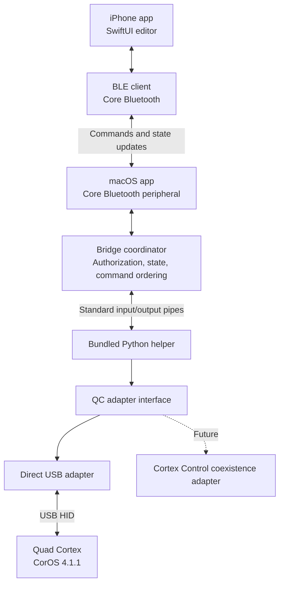

# Patchbridge implementation plan

## Implementation status

The PoC is a native iPhone editor connected over Bluetooth Low Energy to a single macOS bridge app, which connects to the Quad Cortex over USB. It targets CorOS 4.1.1, initially with Cortex Control closed.

All components are implemented and wired for live use. The M3 feasibility gate,
a real edit from the phone confirmed and saved on the QC, has not yet run on
hardware. Simulation is development scaffolding, not hardware compatibility evidence.

| Milestone | Status |
|---|---|
| M1 | Mostly done. Pinned qc-mcp adapter; reads, representative writes, physical-edit polling, and File CREATE persistence passed on the QC. RecallPreset SAVE caused two restarts and is unsupported. |
| M2 | Done. Pairing, explicit authorization, snapshot transfer, and a simulated gain edit and save passed on the physical iPhone. |
| M3 | Software ready, hardware pending. The Mac bridge serves the live USB adapter over BLE to the designed iPhone app. |
| M4 | Built. Preset overview and metadata-driven editor; not yet compared against the QC. |
| M5 | Offline only. Recovery, authorization, and diagnostics are tested offline; radio/USB recovery and latency are unmeasured. |
| M6 | Partial. Bundled-runtime Mac app and TestFlight/Mac App Store release scripts exist; no notarized build or clean-Mac test. |

**Python helper.** Versioned process messages, serialized writes, confirmed-state
responses, session/preset/scene/revision guards, and explicit save. Adapters:
simulated, captured read-only, and direct USB. The USB adapter accepts only
verified 4.1.1 and exposes `set_parameter`, `set_bypass`, `select_scene`,
`list_presets`, `select_preset` (My Presets only) and File CREATE `save`; Save As
is not exposed. Bypass, scenes and presets are not yet verified on hardware. See
[USB results](docs/USB_RESULTS_2026-10-20.md) and [README.md](README.md).

**Mac bridge.** A native app bundles an isolated arm64 CPython runtime (macOS 26+)
with the pinned USB/protobuf dependencies. It opens stopped with live USB/Bluetooth
selected: Start bridge advertises over BLE, and USB opens only after an approved
phone requests a connection. USB loss keeps approval only while the same phone and
helper stay alive; Bluetooth loss, denial, Stop, Quit, or helper death clears it.
**Use simulation** runs the bundled simulator with BLE and USB off. The shell shows
status, approval, recent confirmed edits, recovery, and diagnostics export. See
[Mac bridge shell](docs/MAC_BRIDGE_SHELL.md) and [Mac packaging](docs/MAC_PACKAGING.md).
The bridge does not require a local HTTP server or shared Wi-Fi network.

**iPhone app.** The designed SwiftUI app (iPhone, iPad workspace, and Duo layouts)
drives the transport-injectable `EditorCoordinator` over BLE. It loads capabilities
and relevant catalog metadata, caches by catalog/model identity, polls every 2 s
while idle, and reconciles edits and reconnects without replay. Only parameters with
a declared conversion that are not scene- or expression-assigned are editable;
everything else is shown read-only. A demo mode loads the captured fixture without
a bridge. See [the data-layer contract](docs/METADATA_AND_EDITOR_MODEL.md).

**Safety and verification.** Read-only policy is enforced at the helper/adapter
boundary and by the Swift bridge for captured sessions. Structured diagnostics
export private JSON reports without preset data or identifiers. The offline preflight
checks package provenance, relocated runtime, schemas, read-only policy, report
privacy, and recovery. See [read-only mode](docs/READ_ONLY_QC.md),
[diagnostics](docs/DIAGNOSTICS.md), and [preflight](docs/PREFLIGHT.md).

**Next.** The first live end-to-end hardware run, then scene-specific edits,
nonlinear display accuracy, and recovery/latency baselines. See
[the next hardware session](docs/NEXT_HARDWARE_SESSION.md).

## 1. Product scope

The PoC should demonstrate the complete editing loop:

- Connect the Mac to the QC over USB.
- Discover and authorize the Mac bridge from the iPhone.
- Read the current preset, signal chain, scene, and parameter values.
- Edit amp and effect parameters from the phone.
- Reflect changes made on the QC’s physical controls and touchscreen.
- Switch scenes and presets.
- Save changes explicitly and verify them after reloading.
- Recover cleanly from Bluetooth or USB disconnections.

The goal is broad, metadata-driven parameter editing. We’ll validate numeric controls, switches, dropdowns, nonlinear scales, and scene-specific values rather than assume every parameter behaves identically.

Block insertion, movement, deletion, and routing come after reliable parameter editing. Capture creation, cloud workflows, firmware updates, audio streaming, and IR importing are outside the PoC.

## 2. Architecture



The architecture separates three concerns:

| Layer | Responsibility |
|---|---|
| Phone transport | Discovery, authorization, BLE messages, connection recovery |
| Bridge coordination | Current device state, command ordering, validation, results |
| QC adapter | USB access, handshake, firmware-specific protocol, device events |

The phone will use our own command and state model. It won’t depend on Python classes, raw QC messages, or a particular library.

## 3. Validate CorOS 4.1.1 before choosing the final adapter

Start with qc-mcp’s direct macOS connection, because it selects a 4.1 schema for 4.1.1. That is a starting point for testing, not confirmed compatibility.

Evaluate pyquadcortex against the same tests if its API or transport would simplify the implementation. Its current version checks require an explicit experimental profile for 4.1.1.

Use a disposable preset and record the library commit, firmware, host OS, and hardware identity.

| Test | Required result |
|---|---|
| Handshake | Reliably identify the QC and establish a session |
| Preset read | Correct blocks, positions, scene, bypass states, and values |
| Catalog read | Obtain parameter names, types, ranges, and available options |
| Parameter writes | Correct behavior for representative amp and effect controls |
| Scene edits | Changes affect the intended scene |
| Physical edits | Device-side changes can be observed by the adapter |
| Persistence | Save, switch away, reload, and recover the edited values |
| Reconnection | Disconnect and reconnect without stale writes |

Decision gate: select the library based on demonstrated 4.1.1 behavior. Reuse it behind our adapter interface and pin its version. Avoid combining two session implementations during the PoC.

## 4. Build the Python helper

The helper will own the QC connection and expose a small, versioned command interface over standard input/output.

Initial operations:

- Connect, disconnect, and identify the device.
- Read capabilities and compatibility status.
- Read the current preset and parameter metadata.
- Set a parameter or block bypass state.
- Select a scene or preset.
- Save the current preset or save to another slot.
- Subscribe to device changes.

Messages will distinguish requests, responses, events, and errors. Each request will carry an ID so results can be matched correctly.

Use structured messages framed by newlines for the local process connection. Standard output will contain protocol messages only; diagnostic logs will go to standard error.

The helper must:

- Serialize device writes.
- Report unsupported operations explicitly.
- Distinguish successful transmission from confirmed device state.
- Stop accepting writes when the device disconnects.
- Exit cleanly and release USB ownership.

## 5. Build the macOS wrapper

Use a native Swift app with a small connection/status window and, optionally, a menu-bar entry.

The app will:

- Launch the bundled Python helper using `Process`.
- Monitor startup, output, errors, and termination.
- Manage Bluetooth advertising and phone authorization.
- Forward commands and publish state updates.
- Show QC connection status, firmware, phone connection, and adapter errors.
- Stop the helper when the user disconnects or quits.

A helper crash should produce a visible disconnected state. Restarting should establish a fresh session and reload state rather than retry old edits.

For the first development build, target the Mac architecture available for testing. Broader architecture support comes during packaging.

## 6. Prove the Bluetooth connection separately

Before integrating the QC, build a small simulated parameter service.

The Mac acts as the BLE peripheral and advertises a custom service. The iPhone acts as the central and searches specifically for that service.

Start with:

- A command characteristic for phone-to-Mac messages.
- A notification characteristic for Mac-to-phone results and events.
- A protocol-version and capability exchange.
- An application-level authorization flow requiring confirmation on the Mac.

Discovery must not grant editing permission. Use encrypted BLE characteristics where supported and validate the authorization behavior on the target devices.

The simulation should prove:

- Discovery and connection.
- Bidirectional commands and notifications.
- Transfer of a larger state snapshot.
- Backpressure handling.
- Disconnect and reconnect.
- Rejection of unauthorized commands.

No HTTP listener is needed.

## 7. Define the BLE message protocol

Use a compact, versioned message format. Commands and state updates should have explicit types and identifiers.

Include:

- Request ID.
- Connection/session identifier.
- Preset context or revision.
- Operation and payload.
- Success, failure, or pending result.
- State revision where applicable.

BLE payload limits vary, so large messages must be split using negotiated limits. Chunk headers should identify the transfer, sequence, and completion. Incomplete transfers must expire cleanly.

Apply backpressure rather than allowing unbounded queues. Combine superseded slider updates while ensuring the final requested value is sent.

Prioritize active edits and their results over bulk metadata transfers.

The Mac will retain the full device catalog. The phone should receive the current preset and relevant block metadata first, then request additional information as needed. Cache metadata using device/firmware/catalog identity so updates don’t reuse stale definitions.

## 8. Implement authoritative state and edit handling

The bridge will maintain the latest confirmed QC state.

The phone can display an optimistic slider movement immediately, but it must reconcile that value with the device result. Failed or adjusted edits should be visible.

Critical rules:

- Commands created for one preset must not apply to another.
- Changing scenes must invalidate or complete pending scene-sensitive edits.
- Reconnection creates a fresh session and requests a full snapshot.
- Old queued edits must not replay after reconnecting.
- Device-side changes update the phone.
- Live editing and saving are separate operations.
- Saving does not occur on every slider movement.

Where device events are insufficient, use targeted readback or bounded polling. We’ll establish which operations require that during the hardware investigation.

## 9. Build the iPhone editor

Use SwiftUI with separate UI, state, and transport components. The transport should be replaceable with a simulator for development and testing.

| Screen | Main behavior |
|---|---|
| Connection | Discover bridges, authorize, connect, and show errors |
| Preset overview | Show signal chain, current scene, bypass states, and unsaved changes |
| Block editor | Display controls generated from parameter metadata |
| Preset browser | Select presets and choose Save As destinations |
| Connection details | Show QC firmware, bridge version, and compatibility status |

On the phone, use a compact signal-chain overview that opens a focused block editor.

Parameter controls should support:

- Sliders plus precise numeric entry.
- Units and valid ranges.
- Toggles and option lists.
- Correct nonlinear conversion.
- Scene-aware values.
- Explicit handling of unsupported or unknown metadata.

Do not guess a control’s range or silently substitute a different parameter type.

## 10. Integrate the first end-to-end slice

Connect the Bluetooth simulation to the real Python adapter.

The first successful demonstration must:

1. Discover the Mac from the iPhone.
2. Authorize the phone.
3. Display one real amp block and its values.
4. Change a parameter and confirm the result.
5. Reflect a physical QC knob change on the phone.
6. Save and reload a disposable preset.
7. Recover after disconnecting and reconnecting.

After this works, expand to representative effects, dropdowns, bypass, scenes, and preset switching.

## 11. Package the bridge as one app

The distributable Mac app will contain:

```text
Mac bridge.app
├── Swift application
├── Bluetooth service
├── Python helper
├── Bundled Python runtime
├── QC library and dependencies
├── Required native libraries
└── License notices
```

Users should launch the app and connect their QC without installing development tools.

Packaging work includes:

- Runtime and native-library architecture compatibility.
- Dependency and resource path resolution inside the app bundle.
- Bluetooth permissions and required application configuration.
- Code signing and notarization.
- Clean installation and launch testing on another Mac.
- Retaining the MIT notices for reused code.

The iPhone PoC can initially be installed through development signing, followed by TestFlight when it is ready for broader testing.

## 12. Test reliability and responsiveness

Use three levels of testing:

| Level | Coverage |
|---|---|
| Offline | Message framing, chunk reassembly, state transitions, stale-command rejection, value conversion |
| Simulated integration | Swift/Python process communication, BLE protocol, failures and recovery |
| Hardware | Real QC behavior, BLE responsiveness, persistence, USB ownership and reconnects |

Measure initial loading time, edit-to-confirmation latency, sustained slider behavior, and reconnection time. Set acceptance targets after obtaining baseline results rather than promising throughput in advance.

Exercise Bluetooth disabled, phone backgrounding, Mac sleep/wake, USB removal, helper termination, and preset changes during active editing.

The PoC’s supported operating condition will be an awake Mac and foreground iPhone editor. Background operation can be evaluated separately.

## 13. Leave room for Cortex Control coexistence

Coexistence will be a later adapter implementation behind the same QC-facing interface.

For macOS, qc-mcp’s instrumented Cortex Control approach is a possible foundation. It must be validated against specific Cortex Control versions and treated as an optional integration.

The phone protocol and editor should not need to change when switching adapters.

Coexistence acceptance tests must cover:

- Reading the same active preset.
- Edits originating from either application.
- Concurrent writes and message ordering.
- Cortex Control startup and shutdown.
- Clean fallback or an actionable error when sharing fails.

Direct USB mode remains independently supported.

## 14. Preserve future platform support

The PoC implements macOS only, but the reusable pieces should include:

- Python QC adapter contract.
- Command and state schemas.
- Firmware compatibility records.
- Hardware test procedures.
- Transport-independent editor behavior.

Windows and Linux would receive their own host applications and Bluetooth implementations. A Wi-Fi transport could be added later without changing the QC adapter or the app’s editing model.

## Milestones and deliverables

| Milestone | Deliverable |
|---|---|
| M1 | CorOS 4.1.1 compatibility results and selected QC library |
| M2 | Mac-to-iPhone BLE demonstration using simulated state |
| M3 | Real parameter editing, physical-change feedback, and save/reload |
| M4 | Preset overview and metadata-driven amp/effect editor |
| M5 | Recovery, authorization, and measured performance |
| M6 | Self-contained macOS app and installable iPhone PoC |

M1 and M2 can progress independently. M3 is the principal feasibility gate: it proves that the firmware adapter, bundled helper, Bluetooth link, and iPhone editor work together before we expand the feature set.
