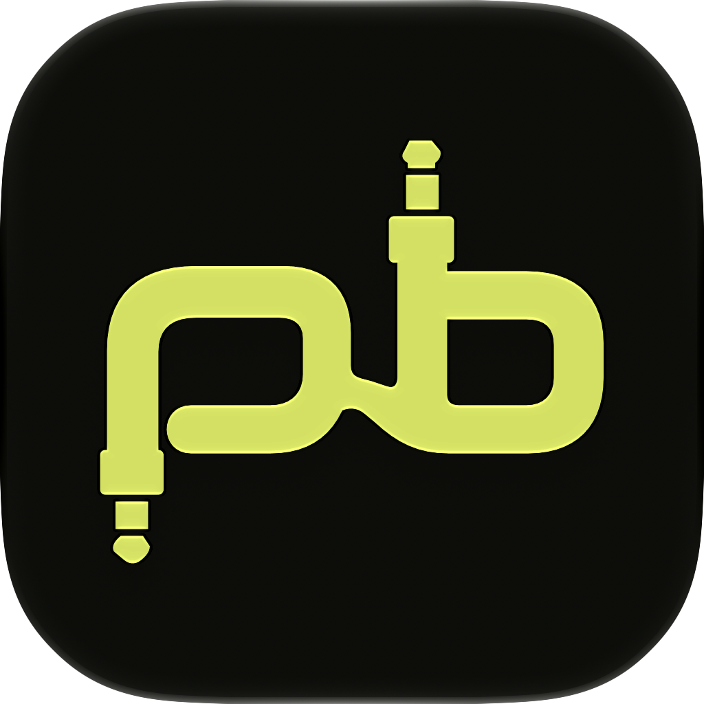
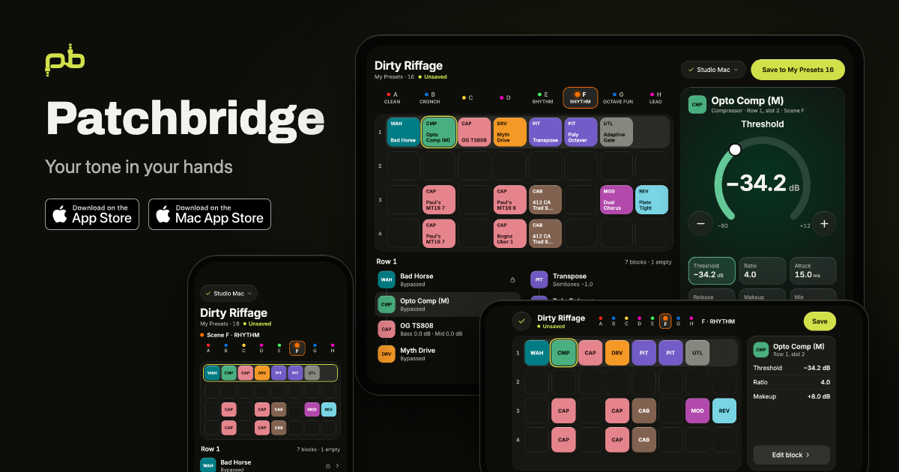

<p align="center">
  
</p>

<h1 align="center">Patchbridge</h1>

<p align="center"><strong>Your tone in your hands.</strong><br>
Edit a Neural DSP Quad Cortex from your iPhone or iPad.</p>

<p align="center">
  <a href="https://patchbridge.arjunakankipati.com">Website</a> ·
  <a href="https://patchbridge.arjunakankipati.com/support">Support</a> ·
  <a href="https://patchbridge.arjunakankipati.com/privacy">Privacy</a> ·
  <a href="#for-developers">For developers</a>
</p>



## What it does

Patchbridge puts the Quad Cortex's signal chain on your phone. You see the grid,
the active scene and every block in a row, tap a block, and turn its parameters
with a dial that confirms each value against the QC before showing it as done.
Save writes back to the preset slot you're already in.

It takes two parts:

- **The iPhone and iPad app** is the editor. It works on iPhone in portrait and
  landscape, on iPad with a persistent editor panel, and on the iPhone Duo's inner
  and outer screens.
- **The Mac bridge** is a small menu bar app. It talks to the QC over USB and
  serves it to your phone over Bluetooth. No Wi-Fi network, no local server, no
  accounts.

The App Store and Mac App Store listings are coming. Until then, see the
[website](https://patchbridge.arjunakankipati.com) and the release scripts below.

## A quick tour

### Connect in three steps

Open the app, pick your Mac, and approve the phone on the Mac with a short code.
Trusted phones reconnect on their own next time.

<table>
<tr>
<td align="center" valign="top"><br><sub>Welcome</sub></td>
<td align="center" valign="top"><br><sub>Choose your Mac</sub></td>
<td align="center" valign="top"><br><sub>Approve on Mac</sub></td>
<td align="center" valign="top"><br><sub>The Mac bridge</sub></td>
</tr>
</table>

### Edit a preset

The overview shows the scenes, the grid and the selected row. Tap a block to open
its editor. The dial sends each change to the QC and shows the value the QC
actually settled on. Anything the QC can't edit remotely is shown read-only
rather than guessed.

<table>
<tr>
<td align="center" valign="top"><br><sub>Preset overview</sub></td>
<td align="center" valign="top"><br><sub>Block editor</sub></td>
<td align="center" valign="top"><br><sub>Save</sub></td>
<td align="center" valign="top"><br><sub>Stage and Daylight themes</sub></td>
</tr>
</table>

### iPad and iPhone Duo

iPad keeps the grid and the editor side by side. The iPhone Duo gets its own
layouts for the inner and outer screens, folded and unfolded.

<table>
<tr>
<td align="center" valign="top"><br><sub>iPad</sub></td>
<td align="center" valign="top"><br><sub>iPhone Duo</sub></td>
</tr>
</table>

### Tuner

A live tuner reads pitch from the QC about ten times a second. The full tuner can
mute your output. The live tuner keeps the pitch on screen while you keep playing,
as a line under the status bar on iPhone, a band in the iPad's top bar, or along
the crease on the Duo.

<table>
<tr>
<td align="center" valign="top"><br><sub>Full tuner</sub></td>
<td align="center" valign="top"><br><sub>Live tuner</sub></td>
<td align="center" valign="top"><br><sub>Live tuner on iPad</sub></td>
</tr>
</table>

More boards, including every edit state, error and the Live Activity, are in
[the design gallery](docs/design/README.md). The visual system is in
[DESIGN.md](DESIGN.md).

## How it stays safe

The QC is your instrument, so the bridge is careful with it.

- **You approve every phone on the Mac.** USB to the QC opens only after that.
- **Writes are confirmed one at a time.** The app shows what the QC reports back,
  not what it hoped to send.
- **Saving is explicit.** Nothing is written to a preset slot until you tap Save,
  and it only saves the slot you're in.
- **Read-only mode is enforced at the boundary**, not just in the UI. See
  [read-only mode](docs/READ_ONLY_QC.md).
- **Diagnostics never include your presets.** Exported reports leave out preset
  contents and device identifiers. See [diagnostics](docs/DIAGNOSTICS.md).

## What it can't do yet

From the phone you can't Save As, bypass a block, change scene or preset, or set
scene-specific values. The USB adapter doesn't expose those yet. Expression and
scene-assigned parameters show read-only.

## Status

All the software is implemented and wired for live use. Pairing, approval,
snapshot transfer and a simulated edit and save have passed between a Mac and a
physical iPhone. The USB adapter is verified on CorOS 4.1.1. The first full
phone-to-Mac-to-QC edit on hardware is the remaining gate; see
[the next hardware session](docs/NEXT_HARDWARE_SESSION.md) and
[hardware validation](docs/HARDWARE_VALIDATION.md).

The product brief is in [PRODUCT.md](PRODUCT.md) and the milestones in
[IMPLEMENTATION_PLAN.md](IMPLEMENTATION_PLAN.md).

---

## For developers

### How it's built

```
iPhone / iPad app  ──Bluetooth──▶  Mac bridge  ──USB──▶  Quad Cortex
   (SwiftUI)                    (SwiftUI + Python helper)
```

| Part | Where | Notes |
|---|---|---|
| iPhone and iPad app | `ios/` | SwiftUI. Controls are generated from the QC's own parameter metadata. [iOS setup](ios/README.md) |
| Shared Swift package | `swift/` | Helper process client, chunked BLE protocol, Core Bluetooth central and peripheral, bridge backend, editor model. [Swift/BLE demo](docs/SWIFT_BLE_DEMO.md) |
| Mac bridge | `mac/` | Menu bar app with a bundled Python runtime. Up to four phones per bridge. [Bridge shell](docs/MAC_BRIDGE_SHELL.md), [multi-device](docs/MULTI_DEVICE_PLAN.md) |
| Python helper | `src/patchbridge/` | Versioned line-delimited JSON protocol. Adapters: simulated, captured read-only, direct USB. [Process protocol](docs/PROCESS_PROTOCOL.md) |
| QC USB transport | `vendor/qc-mcp/` | Vendored and pinned. [VENDORED.md](vendor/qc-mcp/VENDORED.md) |
| Marketing site | `site/` | Astro on Cloudflare Workers. [site/README.md](site/README.md) |

The helper exchanges values in the QC's normalized 0–1 form and passes raw device
metadata through. Display conversion happens in the Swift editor model. The
[metadata and editor model contract](docs/METADATA_AND_EDITOR_MODEL.md) describes
that layer and is tested against captured QC fixtures.

### Run the helper locally

Python 3.11 or newer. The simulator has no external dependencies.

```sh
PYTHONPATH=src python3 -m patchbridge.helper --adapter simulated
```

Enter one JSON request per line:

```json
{"version":1,"type":"request","id":"1","operation":"connect"}
```

The response contains a fresh `session_id`, revision, device identity and preset
snapshot. EOF stops the helper and releases the adapter.

```sh
PYTHONPATH=src python3 -m unittest discover -s tests -v
```

### Direct USB

Generate the qc-mcp protocol descriptors from your installed Cortex Control once
(see [VENDORED.md](vendor/qc-mcp/VENDORED.md)), then:

```sh
python3 -m venv .venv
.venv/bin/python -m pip install -e '.[usb]'
.venv/bin/python -m patchbridge.helper --adapter usb
```

Close Cortex Control first. The USB adapter accepts only verified CorOS 4.1.1. It
supports snapshots, live catalog reads, non-scene-assigned numeric and option
writes, and saving an existing My Presets slot with File CREATE. RecallPreset
SAVE is unsupported after two observed device restarts.

The adapter refreshes state before each edit so it can reject a write that
conflicts with a physical change since the last snapshot. USB can't make that
read/write pair atomic, so simultaneous physical and remote editing still needs
more hardware testing. Errors invalidate the helper session and never trigger
automatic retries. See [USB results](docs/USB_RESULTS_2026-10-20.md).

### Build the Mac app

The bundled Python runtime is built once from pinned, hash-checked CPython and
protobuf sources, so every bundled binary has a dSYM:

```sh
/opt/homebrew/bin/python3 tools/build_runtime.py
/opt/homebrew/bin/python3 tools/package_mac.py
```

See [Mac packaging](docs/MAC_PACKAGING.md). The release Xcode project is generated
from `mac/project.yml`.

### Offline checks and releases

`tools/check_offline.sh` runs the preflight without any device connected. See
[preflight](docs/PREFLIGHT.md).

`./release_ios` and `./release_macos` build and upload to TestFlight. Both accept
`--no-upload`, `--skip-tests`, `--build` and `--allow-dirty`.

### What's not in Git

Build outputs, Python environments, signing material, Xcode user settings and
raw `hardware-results/` captures are excluded. The normalized editor fixture in
`tests/fixtures/` is included. Tests that need raw captures skip when their input
is missing. Full USB fixture checks, packaging and preflight need the local
inputs described in [Mac packaging](docs/MAC_PACKAGING.md).

## License

Source and documentation are [MIT](LICENSE). Third-party dependencies keep their
own licenses; the Mac packager includes their notices.
