# Patchbridge PoC designs

Design boards for the first iPhone build, its iPad layout and its Mac bridge, exported from the design canvas so they can be read without it. The visual system and its rules live in [DESIGN.md](../../DESIGN.md); product intent is in [PRODUCT.md](../../PRODUCT.md).

All screens use the captured preset in `tests/fixtures/qc-editor.json` (scene F) and the scene names and colors from `hardware-results/2026-10-20/initial-preset.json`. As in the app's demo preset (`tests/fixtures/demo-preset.json`), it is renamed **Dirty Riffage** and its row 2 Volume utility is left out. Capture blocks go by their capture name, as in the app. iPhone screens are drawn at iPhone 17 Pro size (402 × 874 pt). All boards use the default **Stage** theme unless marked **Daylight**. iPad screens are drawn at iPad 11" size and are [further down](#ipad). The iPhone Duo boards use the Duo's own screen sizes.

## What's here

| Path | Use it for |
|---|---|
| `screens/*.png` | Reading the designs. Shown below, rendered at 2×. |
| `html/screens/*.html` | Opening a board in a browser to inspect exact CSS, spacing and colors. Click any image below. |
| `ipad/*.png`, `html/ipad/*.html` | The iPad layouts: one screen with a persistent editor panel. |
| `mac/*.png`, `html/mac/*.html` | The Mac bridge window, menu bar popover and notifications. |
| `live/*.png`, `html/live/*.html` | The Live Activity on the Lock Screen and in the Dynamic Island, its setting, and Mac-side trust. |
| `tuner/*.png`, `html/tuner/*.html` | The live tuner on iPhone, iPad and the Duo, and the full tuner. |
| `switching/*.png`, `html/switching/*.html` | Switching scenes from the strip on iPhone, iPad and the Duo: idle, pending, confirmed, not applied and read-only. |
| `presets/*.png`, `html/presets/*.html` | Browsing My Presets on iPhone, iPad and the Duo: first listing, cached list, unsaved edits, switching and the overview reloading. |
| `concepts/`, `html/concepts/` | The earlier A–D concept directions, kept for history. Direction D was chosen. |
| `source/` | The canvas source (`canvas.json` and `.dc.html` boards). Re-import it to keep iterating in the design canvas. |
| `manifest.json` | Board list with titles and sizes, generated by the renderer. |

To regenerate the PNGs and HTML after editing `source/`:

```sh
node tools/render_design_boards.mjs docs/design/source docs/design
```

The renderer has no dependencies; PNGs need Google Chrome. HTML snapshots render with the Mac's own SF Pro, so they're closer to iOS than the canvas preview. Glass blur is approximated with CSS `backdrop-filter`; the app uses SwiftUI's Liquid Glass.

## Connect

Getting the Mac app, finding and approving the Mac, loading, and recoverable errors.

<table>
<tr><td align="center" valign="top"><a href="html/screens/c-welcome.html"></a><br><sub>Welcome</sub></td><td align="center" valign="top"><a href="html/screens/c-getmac.html"></a><br><sub>Get the Mac app</sub></td><td align="center" valign="top"><a href="html/screens/c-linksent.html"></a><br><sub>Link sent to Mac</sub></td><td align="center" valign="top"><a href="html/screens/c-found.html"></a><br><sub>Choose your Mac</sub></td></tr>
<tr><td align="center" valign="top"><a href="html/screens/c-approve.html"></a><br><sub>Approve on Mac</sub></td><td align="center" valign="top"><a href="html/screens/c-loading.html"></a><br><sub>Loading the QC</sub></td><td align="center" valign="top"><a href="html/screens/c-lost.html"></a><br><sub>Error: connection ended</sub></td><td align="center" valign="top"><a href="html/screens/c-timeout.html"></a><br><sub>Error: no reply</sub></td></tr>
<tr><td align="center" valign="top"><a href="html/screens/c-bluetooth.html"></a><br><sub>Error: Bluetooth off</sub></td></tr>
</table>

## Preset overview

Scenes from the QC, switching scenes, the grid map, the selected row, saving, device changes and connection details.

<table>
<tr><td align="center" valign="top"><a href="html/screens/o-row1.html"></a><br><sub>Overview · row 1</sub></td><td align="center" valign="top"><a href="html/screens/o-row3.html"></a><br><sub>Overview · row 3</sub></td><td align="center" valign="top"><a href="html/screens/o-demo.html"></a><br><sub>Overview · demo mode</sub></td><td align="center" valign="top"><a href="html/screens/o-save.html"></a><br><sub>Save confirmation</sub></td></tr>
<tr><td align="center" valign="top"><a href="html/screens/o-saving.html"></a><br><sub>Saving</sub></td><td align="center" valign="top"><a href="html/screens/o-saved.html"></a><br><sub>Saved</sub></td><td align="center" valign="top"><a href="html/screens/o-changed.html"></a><br><sub>Changed on the QC</sub></td><td align="center" valign="top"><a href="html/screens/o-details.html"></a><br><sub>Connection details</sub></td></tr>
<tr><td colspan="2" align="center" valign="top"><a href="html/screens/o-landscape.html"></a><br><sub>Overview · landscape</sub></td></tr>
</table>

### Switching scenes

The scene strip is now a set of buttons on iPhone and iPad; on the iPhone Duo the scenes are pads in the bottom half. Tapping a scene asks the QC to switch, and the strip always draws the scene the QC has confirmed as active. These boards start from a saved preset, so they also show that Save stays off throughout.

- **Idle.** Every scene is a 44 pt button with a thin outline. The active scene has a filled cell, a ring in its own colour, a larger glowing dot and a bold letter. The line above the strip names the active scene.
- **Pending.** The tapped scene gets a dashed chartreuse ring, the same mark as a value being sent. The old scene stays active, and the line above reads "Switching to B". If you tap another scene while one is pending, the newer tap replaces it. If no reply comes, the result is "Outcome unknown", as with values; a timeout is never shown as "Not applied".
- **Confirmed.** The ring, glow and title move to the new scene only after the QC replies. The grid and the row's summaries redraw that scene's bypass states (scene B here, from the captured preset). "On the QC" shows briefly and then clears. Haptics: a selection tick on tap and a success tap on confirmation.
- **Rejected ("Not applied").** The QC keeps its scene. The tapped cell gets an amber ring and an "!" badge, and the status reads "Not applied", so the state never depends on colour alone. Tapping the cell again retries. VoiceOver says "Scene D not applied. The QC stayed on Scene F · RHYTHM."
- **Read-only connection.** The strip still follows the QC, including changes made on the unit, but its buttons are disabled. The cells lose their outlines, the inactive dots dim, and the line reads "Read-only" with a lock.
- **Names and colours come from the QC** (`scene_labels`, `scene_colors`). A blank name falls back to the letter alone (scenes C and D). A missing colour falls back to a neutral dot.
- **Not part of Save.** A scene change never sets the dirty flag, never shows "Unsaved" and never enables Save. Unsaved edits made before a switch stay unsaved.
- **Per device.** On iPhone the status sits on the right of the scene title. On iPad it appears in the toast slot in the top bar, using the same toast as Saved and Changed on the QC, and names both scenes. On the Duo the scene pads in the deck switch scenes, and the status appears in the deck header. Compact strips (the Duo header while a block is open, the Duo's outer screen, iPhone landscape) mirror the QC but stay display-only, because their cells are under 44 pt.
- **Motion.** The ring and glow cross-fade over 240 ms with ease-out-quart. With Reduce Motion they switch instantly.

<table>
<tr><td align="center" valign="top"><a href="html/switching/poc-sc-idle.html">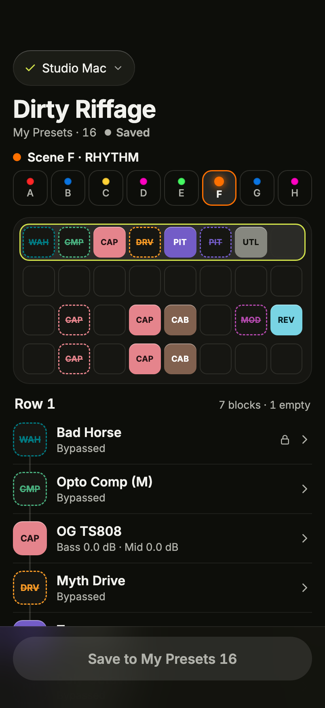</a><br><sub>iPhone · idle</sub></td><td align="center" valign="top"><a href="html/switching/poc-sc-pending.html">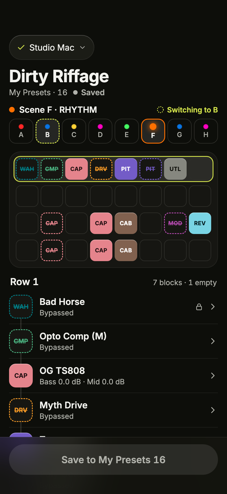</a><br><sub>iPhone · pending</sub></td><td align="center" valign="top"><a href="html/switching/poc-sc-confirmed.html">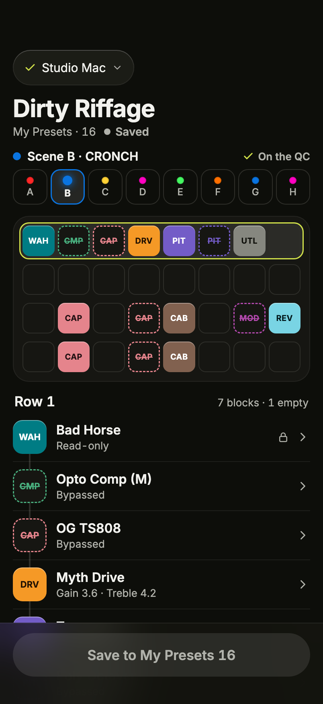</a><br><sub>iPhone · confirmed</sub></td><td align="center" valign="top"><a href="html/switching/poc-sc-rejected.html">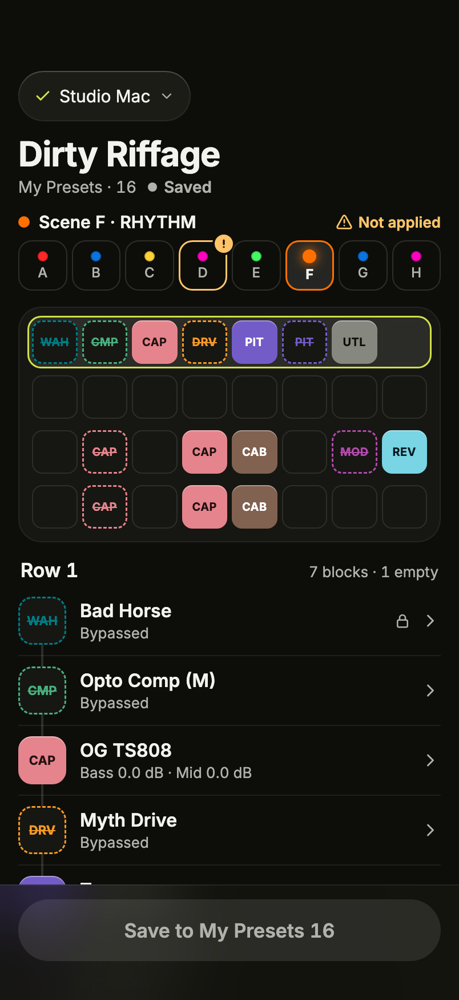</a><br><sub>iPhone · not applied</sub></td></tr>
<tr><td align="center" valign="top"><a href="html/switching/poc-sc-readonly.html"></a><br><sub>iPhone · read-only</sub></td></tr>
</table>

<table>
<tr><td align="center" valign="top"><a href="html/switching/ipad-sc-idle.html">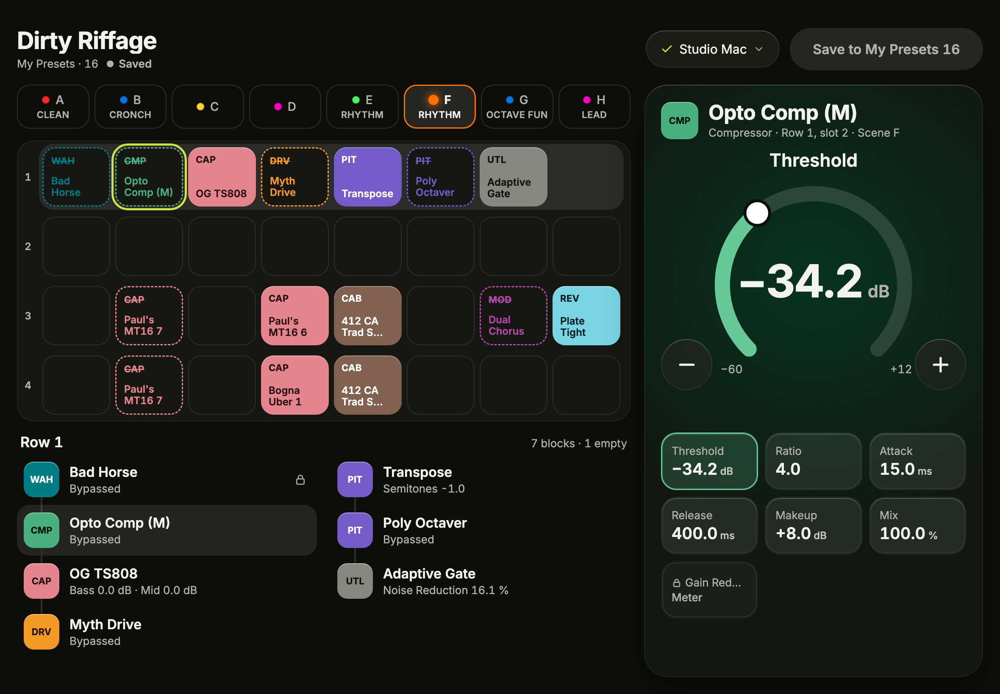</a><br><sub>iPad · idle</sub></td><td align="center" valign="top"><a href="html/switching/ipad-sc-pending.html">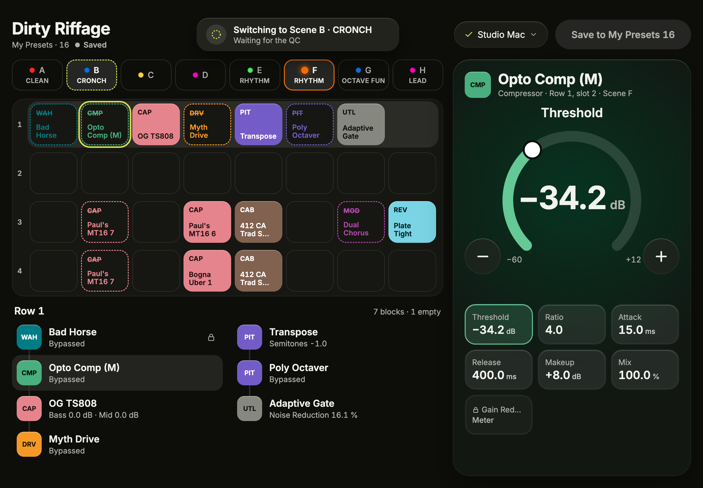</a><br><sub>iPad · pending</sub></td><td align="center" valign="top"><a href="html/switching/ipad-sc-confirmed.html">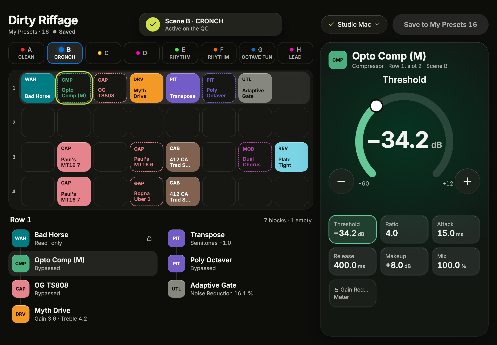</a><br><sub>iPad · confirmed</sub></td></tr>
<tr><td align="center" valign="top"><a href="html/switching/ipad-sc-rejected.html">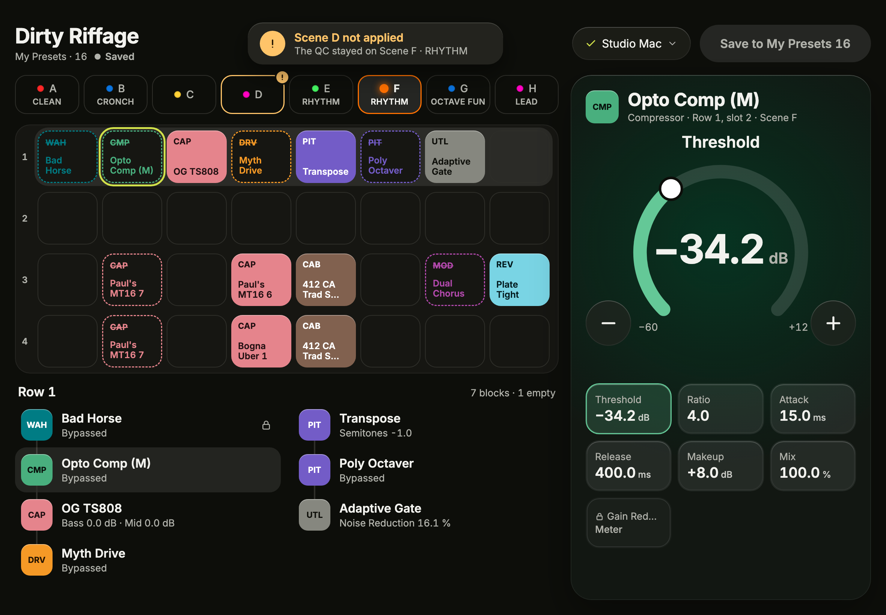</a><br><sub>iPad · not applied</sub></td><td align="center" valign="top"><a href="html/switching/ipad-sc-readonly.html"></a><br><sub>iPad · read-only</sub></td></tr>
</table>

<table>
<tr><td align="center" valign="top"><a href="html/switching/duo-sc-idle.html">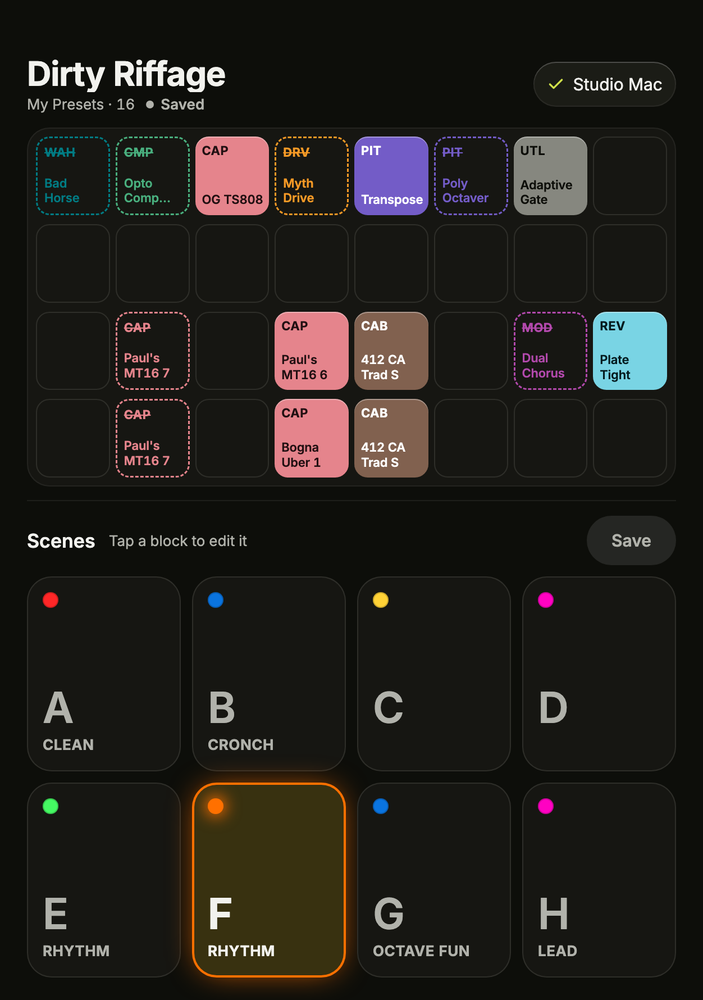</a><br><sub>Duo · idle</sub></td><td align="center" valign="top"><a href="html/switching/duo-sc-pending.html">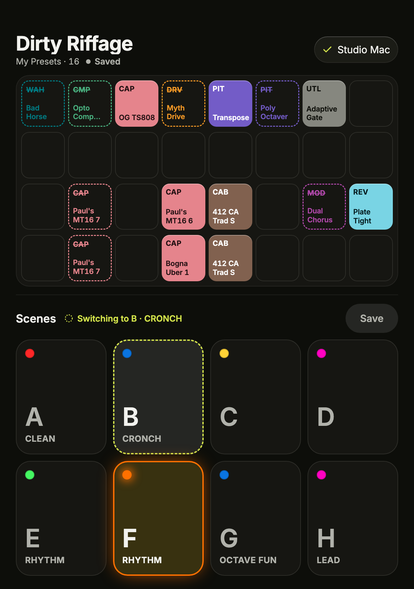</a><br><sub>Duo · pending</sub></td><td align="center" valign="top"><a href="html/switching/duo-sc-confirmed.html">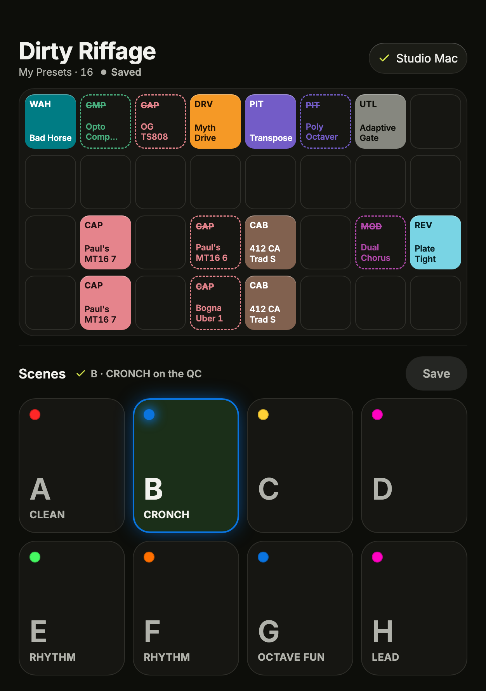</a><br><sub>Duo · confirmed</sub></td><td align="center" valign="top"><a href="html/switching/duo-sc-rejected.html">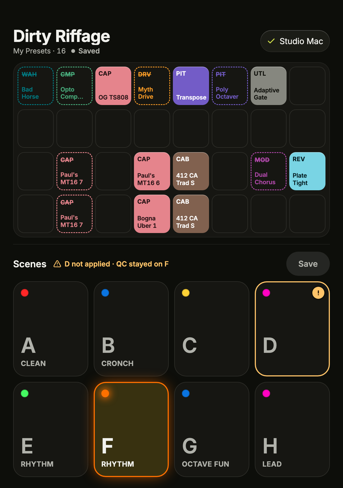</a><br><sub>Duo · not applied</sub></td></tr>
<tr><td align="center" valign="top"><a href="html/switching/duo-sc-readonly.html">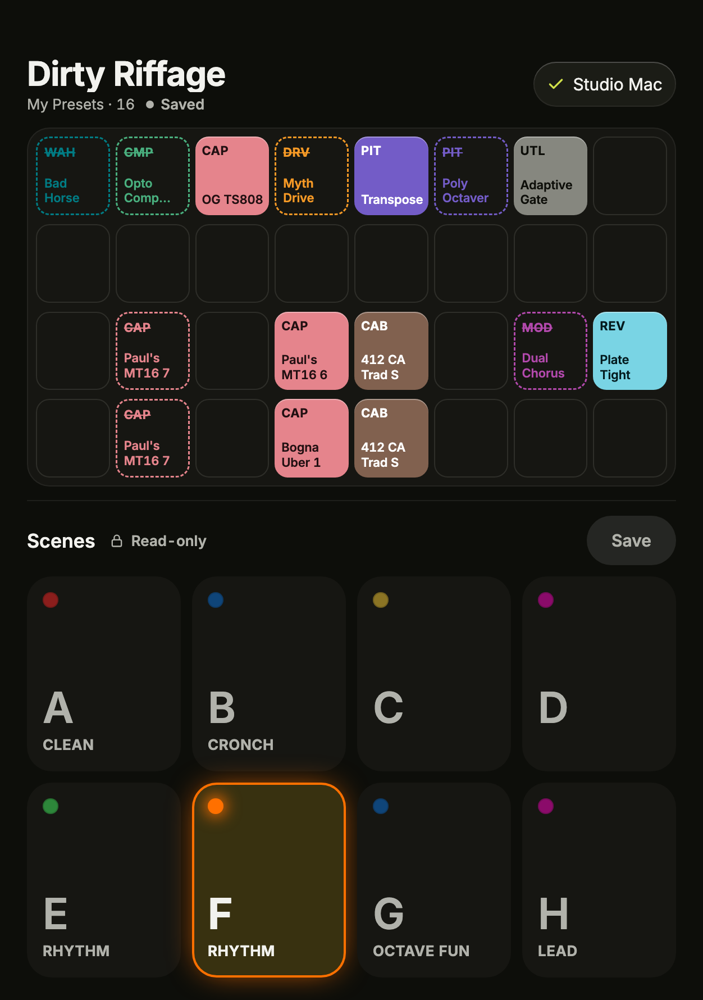</a><br><sub>Duo · read-only</sub></td></tr>
</table>

Source: the `scene` and `dirty` Tweaks on `source/poc/Overview.dc.html`, `source/ipad/Workspace.dc.html` and `source/duo/Inner.dc.html`; the boards are `source/*/sc-*.dc.html` on the canvas's Scene switching page. To render just them, run `node tools/render_design_boards.mjs docs/design/source docs/design switching`.

### Browsing presets

The preset name in the overview header opens My Presets, and tapping a preset loads it on the QC. Factory Presets, Downloads and plugin presets come later.

- **Way in.** The name is a button with a chevron (`presetMenu` Tweak). The browser opens scrolled to the loaded slot: a large sheet on iPhone, a popover from the name on iPad, and the control deck below the fold on the Duo, so folding never moves it.
- **The list.** My Presets is the QC's fixed 256-slot table. Each used slot shows its number and name. Empty slots between presets read "Empty" and can't be tapped; the empty run at the end collapses into one row ("Slots 19–256 are empty"). The loaded slot has a check, a tint and "Loaded", plus "unsaved edits" when it has them.
- **First listing.** The bridge reads the directory in one go, in about 12 seconds, so there is no per-row progress. The loaded slot shows at once and the rest is a skeleton under an indeterminate bar. Closing the browser doesn't stop the read.
- **Cached list.** After that the list is kept and says when it was read ("Listed at 9:41 PM"). Refresh re-reads it; the old list stays usable meanwhile.
- **Unsaved edits.** Before switching, the app lists each unsaved edit with its saved value, with a QC tag for edits made on the unit. Save and switch saves to the current slot and then loads; Switch anyway (in Danger) discards them; Cancel stays.
- **Switching.** The target row gets the dashed pending outline. The current preset stays marked as loaded until the QC confirms the switch. Then the overview redraws as a skeleton under the new name and slot until the QC reports the preset.
- **Other sources.** Factory Presets, Downloads and Plugin presets appear as disabled headers that say "Not yet": below the list on iPhone, and in a sources column on iPad and the Duo.
- **Motion.** The bar sweeps and spinners turn; with Reduce Motion both hold still.

<table>
<tr><td align="center" valign="top"><a href="html/presets/poc-pb-entry.html">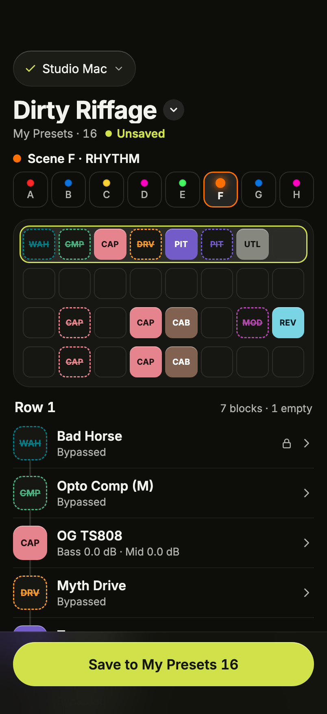</a><br><sub>iPhone · entry</sub></td><td align="center" valign="top"><a href="html/presets/poc-pb-loading.html">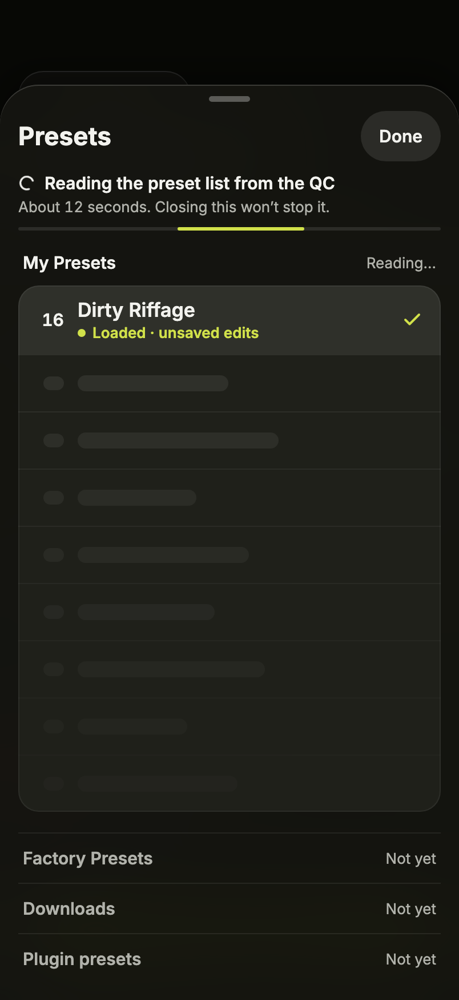</a><br><sub>iPhone · first listing</sub></td><td align="center" valign="top"><a href="html/presets/poc-pb-cached.html">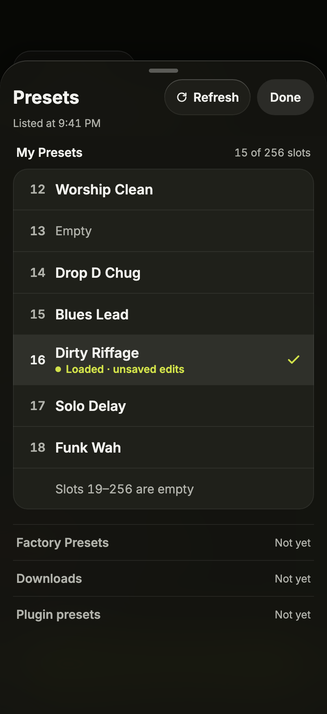</a><br><sub>iPhone · cached list</sub></td><td align="center" valign="top"><a href="html/presets/poc-pb-refreshing.html">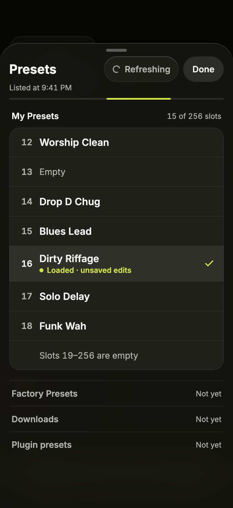</a><br><sub>iPhone · refreshing</sub></td></tr>
<tr><td align="center" valign="top"><a href="html/presets/poc-pb-confirm.html">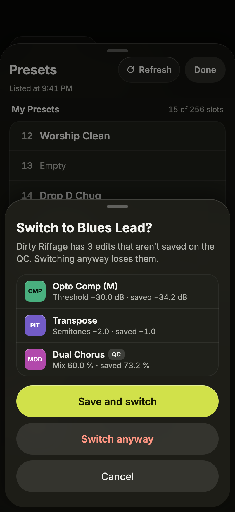</a><br><sub>iPhone · unsaved edits</sub></td><td align="center" valign="top"><a href="html/presets/poc-pb-switching.html">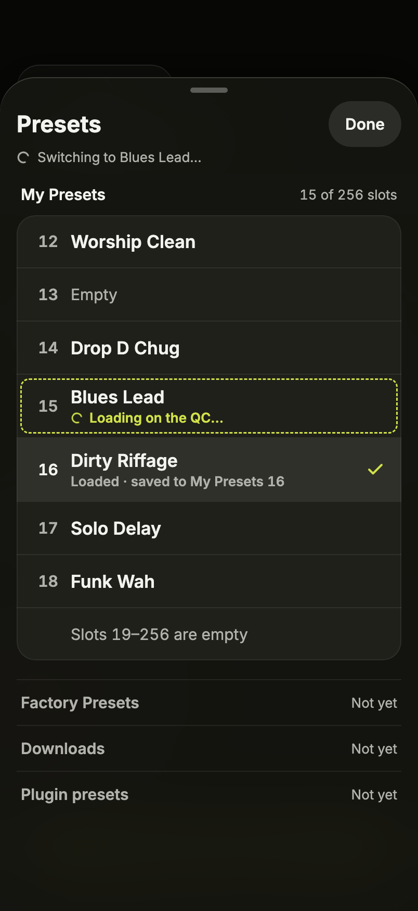</a><br><sub>iPhone · saved, loading 15</sub></td><td align="center" valign="top"><a href="html/presets/poc-pb-reloading.html">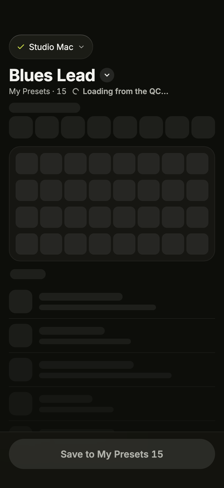</a><br><sub>iPhone · overview reloading</sub></td></tr>
</table>

<table>
<tr><td align="center" valign="top"><a href="html/presets/ipad-ipb-loading.html">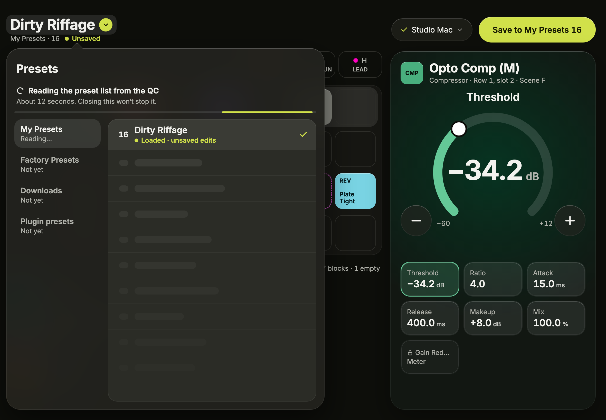</a><br><sub>iPad · first listing</sub></td><td align="center" valign="top"><a href="html/presets/ipad-ipb-cached.html">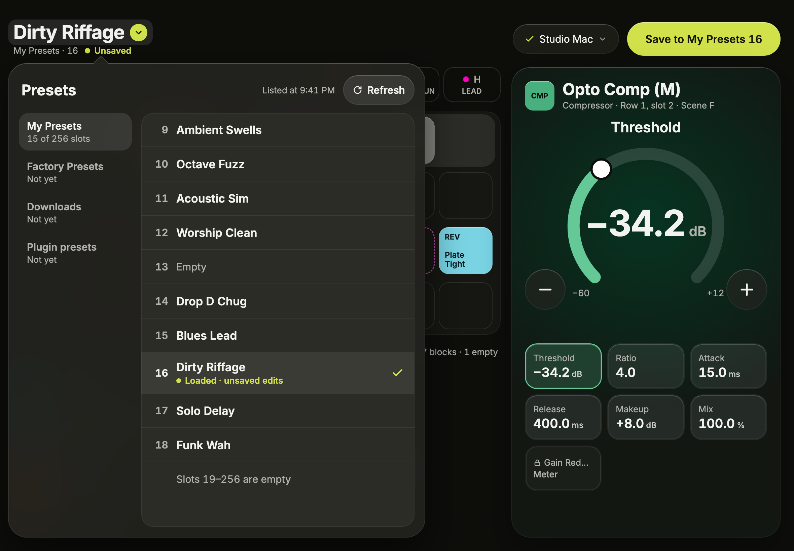</a><br><sub>iPad · cached list</sub></td><td align="center" valign="top"><a href="html/presets/ipad-ipb-confirm.html">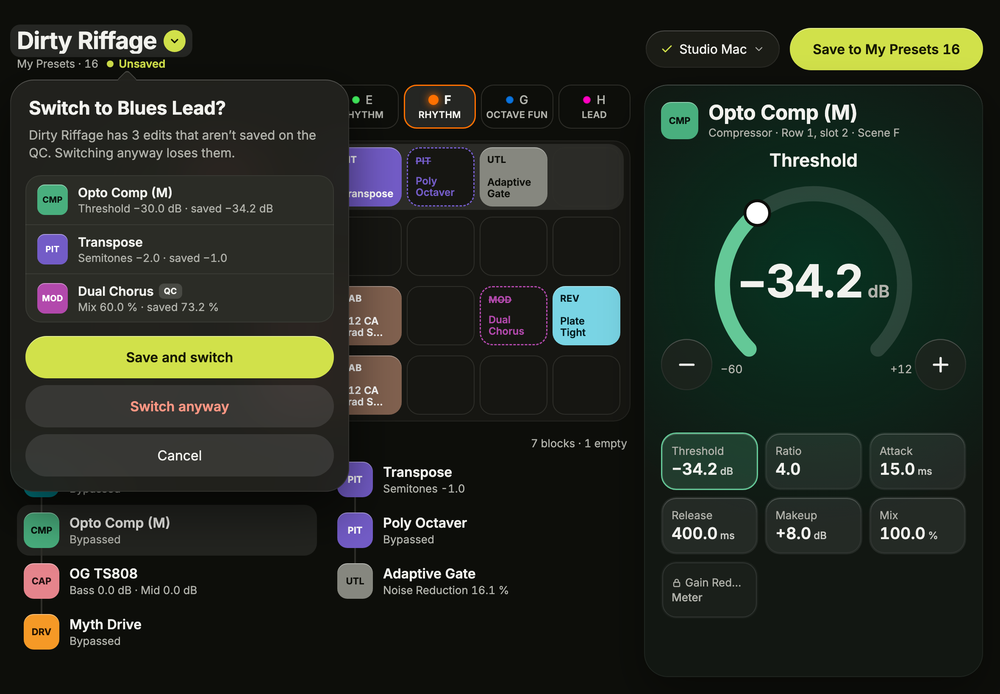</a><br><sub>iPad · unsaved edits</sub></td></tr>
<tr><td align="center" valign="top"><a href="html/presets/ipad-ipb-reloading.html">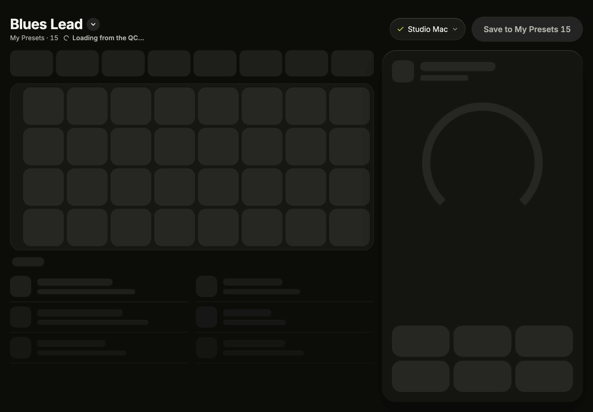</a><br><sub>iPad · overview reloading</sub></td></tr>
</table>

<table>
<tr><td align="center" valign="top"><a href="html/presets/duo-dpb-loading.html">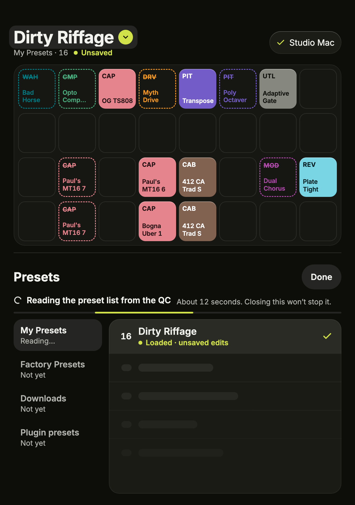</a><br><sub>Duo · first listing</sub></td><td align="center" valign="top"><a href="html/presets/duo-dpb-cached.html">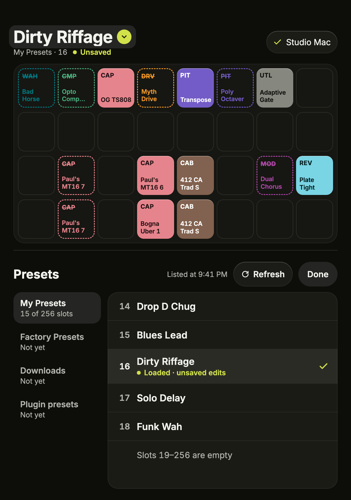</a><br><sub>Duo · cached list</sub></td><td align="center" valign="top"><a href="html/presets/duo-dpb-confirm.html">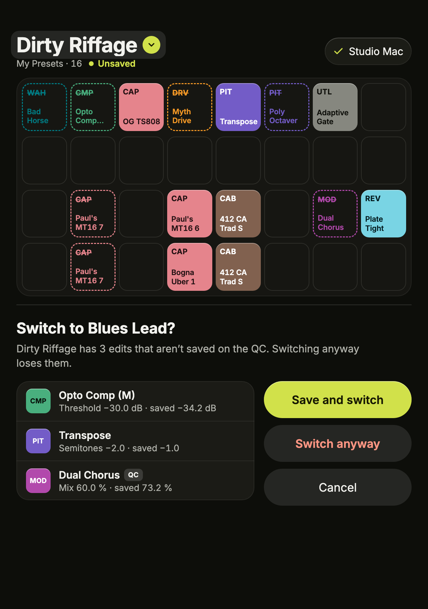</a><br><sub>Duo · unsaved edits</sub></td><td align="center" valign="top"><a href="html/presets/duo-dpb-reloading.html">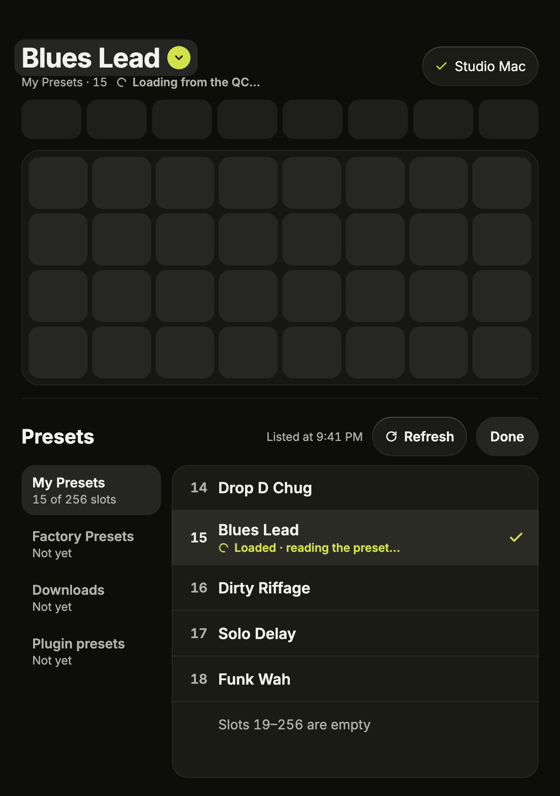</a><br><sub>Duo · view reloading</sub></td></tr>
</table>

Source: `source/poc/PresetBrowser.dc.html`, `source/ipad/PadPresets.dc.html` and `source/duo/DuoPresets.dc.html` (`state` Tweak), which mount the overview components with `presetMenu` on; the boards are `source/*/pb-*`, `ipb-*` and `dpb-*` on the canvas's Preset browser page. The preset names other than Dirty Riffage are placeholders. To render just them, run `node tools/render_design_boards.mjs docs/design/source docs/design presets`.

## Block editor

The dial in every edit state, typing, read-only and option parameters.

<table>
<tr><td align="center" valign="top"><a href="html/screens/e-idle.html"></a><br><sub>Editor · matches the QC</sub></td><td align="center" valign="top"><a href="html/screens/e-fine.html"></a><br><sub>Editor · fine steps (hold, slide out)</sub></td><td align="center" valign="top"><a href="html/screens/e-pending.html"></a><br><sub>Editor · sending</sub></td><td align="center" valign="top"><a href="html/screens/e-confirmed.html"></a><br><sub>Editor · confirmed</sub></td></tr>
<tr><td align="center" valign="top"><a href="html/screens/e-adjusted.html"></a><br><sub>Editor · adjusted by the QC</sub></td><td align="center" valign="top"><a href="html/screens/e-rejected.html"></a><br><sub>Editor · not applied</sub></td><td align="center" valign="top"><a href="html/screens/e-typing.html"></a><br><sub>Editor · typing</sub></td><td align="center" valign="top"><a href="html/screens/e-invalid.html"></a><br><sub>Editor · out of range</sub></td></tr>
<tr><td align="center" valign="top"><a href="html/screens/e-capture.html"></a><br><sub>Editor · read-only capture</sub></td><td align="center" valign="top"><a href="html/screens/e-chorus.html"></a><br><sub>Editor · option parameter</sub></td></tr>
</table>

## Scene parameters

How the editor handles parameters that have their own value in each scene. They're drawn on the Dual Chorus, with Mix and Tone assigned per scene, Width global and Depth on Expression 1. The per-scene values are illustrative.

- **Edit the active scene only.** A scene marker (the scene's dot and letter) sits on the dial above the value, and the same marker follows the label on the parameter's tile. Global parameters carry no marker. The status line says "Edits scene F only" or, for a global parameter, "Applies to all scenes".
- **Other scenes stay visible.** Under the dial, a flat read-only strip lists all eight scenes' values in A–H order. The active scene keeps its slot, outlined in its own color, so nothing moves when you switch. A global parameter shows a "Same in every scene" row in the same space, so the tiles never shift.
- **Switching scene keeps your place.** The scene pill in the header switches the scene on the QC and keeps the block and parameter selected. The dial shows "—" and pauses input until the bridge returns the new scene's value, then confirms "Now editing scene G". Scene switching stays hidden until the bridge advertises it.
- **Expression is a different lock.** Expression-controlled parameters stay read-only, with a pedal glyph instead of the padlock and the heel-to-toe sweep shown on the arc and beside it. The padlock stays for the other reasons (meter, unknown scale, depends on Sync).

<table>
<tr><td align="center" valign="top"><a href="html/screens/s-idle.html">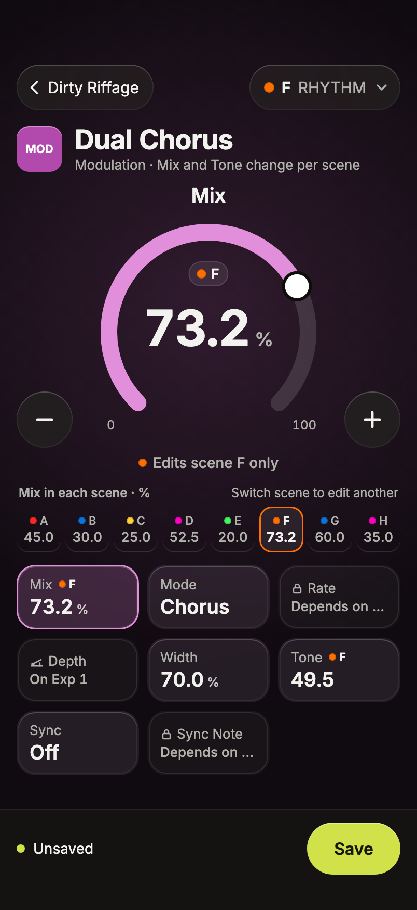</a><br><sub>Scene parameter · editing scene F</sub></td><td align="center" valign="top"><a href="html/screens/s-pending.html">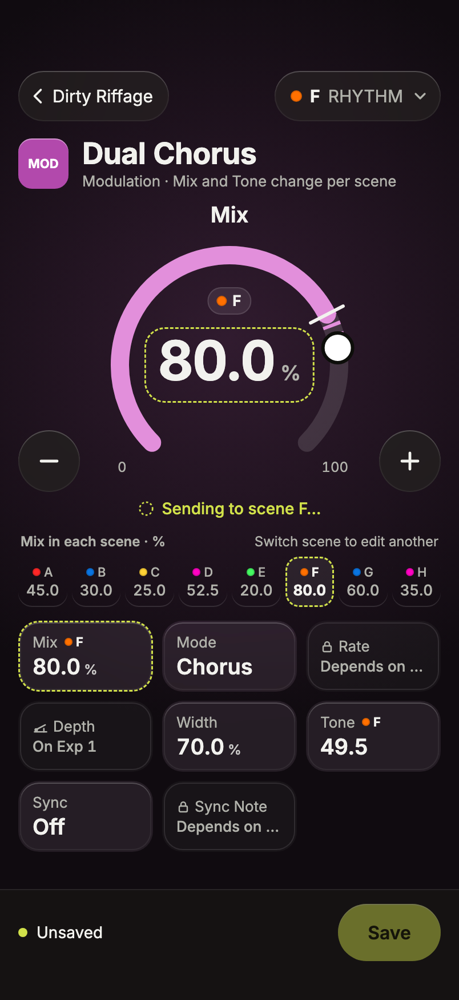</a><br><sub>Sending to scene F</sub></td><td align="center" valign="top"><a href="html/screens/s-menu.html">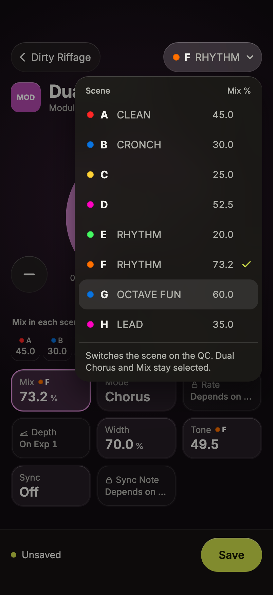</a><br><sub>Choosing a scene</sub></td><td align="center" valign="top"><a href="html/screens/s-loading.html">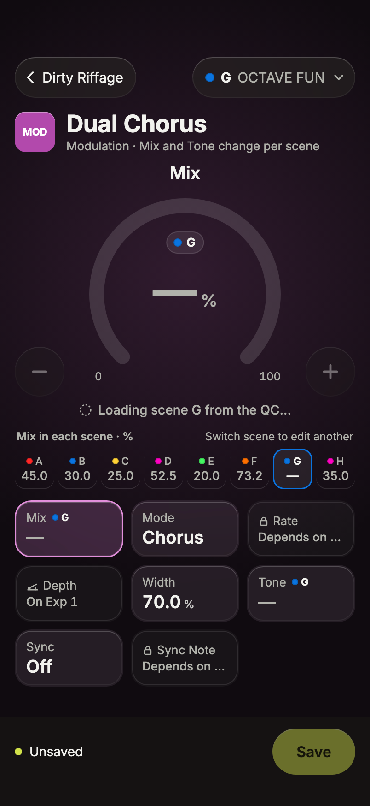</a><br><sub>Switched to G, dial reloading</sub></td></tr>
<tr><td align="center" valign="top"><a href="html/screens/s-loaded.html">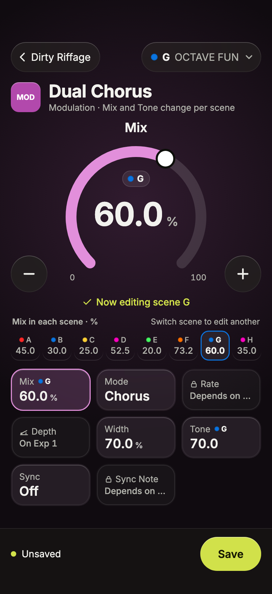</a><br><sub>Editing scene G</sub></td><td align="center" valign="top"><a href="html/screens/s-global.html">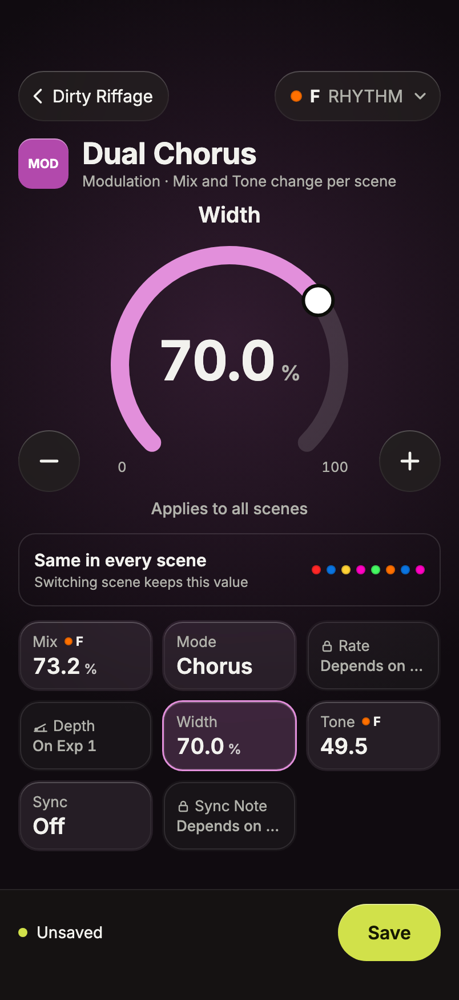</a><br><sub>Global parameter · all scenes</sub></td><td align="center" valign="top"><a href="html/screens/s-expression.html">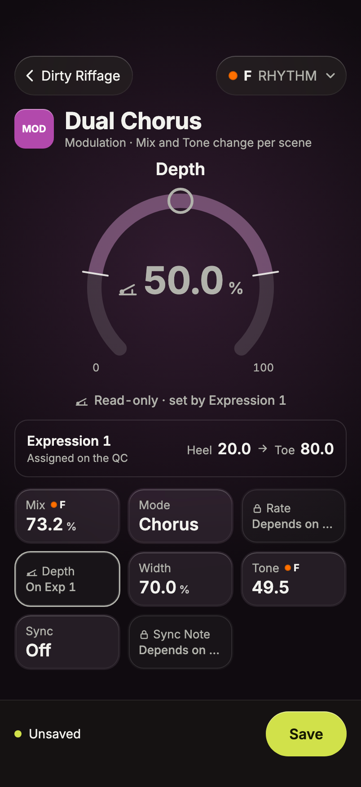</a><br><sub>Expression parameter · read-only</sub></td><td align="center" valign="top"><a href="html/screens/s-daylight.html">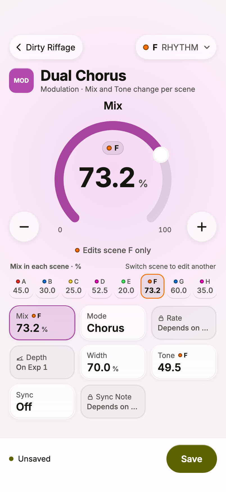</a><br><sub>Daylight · scene parameter</sub></td></tr>
</table>

## Themes

Appearance settings and the Daylight theme.

<table>
<tr><td align="center" valign="top"><a href="html/screens/t-appearance-stage.html"></a><br><sub>Appearance · Stage</sub></td><td align="center" valign="top"><a href="html/screens/t-appearance-daylight.html"></a><br><sub>Appearance · Daylight</sub></td><td align="center" valign="top"><a href="html/screens/t-overview.html"></a><br><sub>Daylight · overview</sub></td><td align="center" valign="top"><a href="html/screens/t-editor.html"></a><br><sub>Daylight · editor</sub></td></tr>
<tr><td align="center" valign="top"><a href="html/screens/t-fine.html"></a><br><sub>Daylight · fine steps</sub></td><td align="center" valign="top"><a href="html/screens/t-pending.html"></a><br><sub>Daylight · sending</sub></td><td align="center" valign="top"><a href="html/screens/t-connect.html"></a><br><sub>Daylight · approve on Mac</sub></td></tr>
<tr><td colspan="2" align="center" valign="top"><a href="html/screens/t-landscape.html"></a><br><sub>Daylight · landscape</sub></td></tr>
</table>

## iPhone Duo

The foldable, in its three postures. The inner screen is 626 × 890 pt and the outer screen 466 × 678 pt. The outer screen is about half as wide as the inner screen is tall, so the hinge runs across the inner screen's long side: held upright and half-folded, the fold sits at y ≈ 445. Postures change the layout, not the model: the same grid, scenes, dial and save rules apply everywhere.

- **Inner screen, flat and half-folded:** one layout in both postures, split at the hinge. The top half is the view (the header and the named grid). The bottom half is the deck, which shows the scene pads by default. The deck is identical in both postures, so folding never moves what is under your fingers.
- **Scene pads by default.** The deck holds the eight scenes as large pads, two rows of four, like the QC's footswitches. Each pad has an LED dot in the scene's colour, the letter and the QC's name for the scene. Half-folded, they lie flat on the table like a pedalboard. Tapping a pad switches scene, with the same pending, confirmed, not applied and read-only states as the strips. The deck header says "Tap a block to edit it".
- **Tapping a block swaps the pads for its controls:** the dial, the parameter tiles and, when typing, the number pad. The block stays outlined in the grid. **Scenes** at the top left goes back to the pads. While the controls are open, the header shows the compact scene strip, so the active scene stays visible. That strip is display-only.
- **Folding** changes only the view. The status pill shrinks to its icon, the title tightens and the crease shadow fades in. It is one 560 ms ease-out-quint motion. Opening a block's controls brings the compact scene strip into the header with the same motion, 120 ms in. With Reduce Motion it switches instantly. The fold prototype boards show it in 3D; the Play version lives in the design canvas. Nothing interactive sits within 14 pt of the fold. The dark band on the half-folded boards marks the hinge and isn't part of the UI.
- **Folded, outer screen in landscape (the main folded posture):** the whole named grid fills the screen under a one-line header with status, name, scenes and Save. Tapping a block opens the block menu as a side panel with the first four controls and Open editor. The grid narrows to codes beside it, so no row is covered and tapping another block swaps the menu's contents.
- **Folded, outer screen in portrait:** the same idea with the menu as a medium-height sheet with no dimming, which leaves the top rows visible.

<table>
<tr><td align="center" valign="top"><a href="html/screens/duo-u-row.html"></a><br><sub>Unfolded · scenes</sub></td><td align="center" valign="top"><a href="html/screens/duo-u-idle.html"></a><br><sub>Unfolded · editing</sub></td><td align="center" valign="top"><a href="html/screens/duo-u-pending.html"></a><br><sub>Unfolded · sending a value</sub></td></tr>
<tr><td align="center" valign="top"><a href="html/screens/duo-h-row.html"></a><br><sub>Half-folded · scenes</sub></td><td align="center" valign="top"><a href="html/screens/duo-h-edit.html"></a><br><sub>Half-folded · editing</sub></td><td align="center" valign="top"><a href="html/screens/duo-h-type.html"></a><br><sub>Half-folded · typing a value</sub></td></tr>
<tr><td align="center" valign="top"><a href="html/screens/duo-Fold.html"></a><br><sub>Fold prototype · unfolded</sub></td><td align="center" valign="top"><a href="html/screens/duo-f-half.html"></a><br><sub>Fold prototype · half-folded</sub></td></tr>
<tr><td align="center" valign="top"><a href="html/screens/duo-xl-grid.html"></a><br><sub>Outer landscape · grid</sub></td><td align="center" valign="top"><a href="html/screens/duo-xl-sheet.html"></a><br><sub>Outer landscape · block menu</sub></td></tr>
<tr><td align="center" valign="top"><a href="html/screens/duo-xl-pending.html"></a><br><sub>Outer landscape · block menu, sending</sub></td></tr>
<tr><td align="center" valign="top"><a href="html/screens/duo-x-grid.html"></a><br><sub>Outer portrait · grid</sub></td><td align="center" valign="top"><a href="html/screens/duo-x-sheet.html"></a><br><sub>Outer portrait · block menu</sub></td><td align="center" valign="top"><a href="html/screens/duo-x-pending.html"></a><br><sub>Outer portrait · block menu, sending</sub></td></tr>
</table>

## iPad

The same flows at regular width, drawn at iPad 11" size (1180 × 820 pt landscape, 820 × 1180 pt portrait) in the **Stage** theme only. Slugs match the iPhone board each one stands in for. There's no separate editor-idle board, because on iPad the overview *is* the idle editor.

What changes from iPhone:

- **One screen, no push.** The grid, the selected row's list and a persistent editor panel share the screen. Tapping a block in the grid or the list retargets the panel; the selected block keeps the Signal outline and its row keeps the band.
- **Named blocks.** Grid cells are 70 pt tall and show the code plus up to two lines of the block name. The row list keeps the real-value summaries, in two columns in landscape.
- **Scene names in the strip.** Each scene cell shows its dot, letter and QC name; a blank name falls back to the letter alone.
- **Popovers instead of sheets.** The number pad points at the value it edits, Save confirmation hangs from Save, and Connection details (with Appearance pushed inside it) hangs from the status pill. Popovers are 95% opaque so keys never read over the tiles beneath.
- **Toasts sit in the top bar's free space**, between the preset name and the status pill.
- **Connect is a centred column** with the larger iPad → Mac → QC diagram, and loading draws a skeleton of the split layout.
- **Portrait** keeps scenes and grid full width and puts the row list beside the editor panel.
- **Split View and Slide Over** at compact width use the iPhone layout unchanged, so they aren't drawn.

Source: `source/ipad/Workspace.dc.html` and `source/ipad/Connect.dc.html`. The board wrappers and their canvas entries are generated by `node tools/ipad_boards.mjs`; render just this page with `node tools/render_design_boards.mjs docs/design/source docs/design ipad`.

### iPad · Connect

<table>
<tr><td align="center" valign="top"><a href="html/ipad/c-welcome.html"></a><br><sub>Welcome</sub></td><td align="center" valign="top"><a href="html/ipad/c-getmac.html"></a><br><sub>Get the Mac app</sub></td><td align="center" valign="top"><a href="html/ipad/c-linksent.html"></a><br><sub>Link sent to Mac</sub></td></tr>
<tr><td align="center" valign="top"><a href="html/ipad/c-found.html"></a><br><sub>Choose your Mac</sub></td><td align="center" valign="top"><a href="html/ipad/c-approve.html"></a><br><sub>Approve on Mac</sub></td><td align="center" valign="top"><a href="html/ipad/c-loading.html"></a><br><sub>Loading the QC</sub></td></tr>
<tr><td align="center" valign="top"><a href="html/ipad/c-lost.html"></a><br><sub>Error: connection ended</sub></td><td align="center" valign="top"><a href="html/ipad/c-timeout.html"></a><br><sub>Error: no reply</sub></td><td align="center" valign="top"><a href="html/ipad/c-bluetooth.html"></a><br><sub>Error: Bluetooth off</sub></td></tr>
</table>

### iPad · Overview

<table>
<tr><td align="center" valign="top"><a href="html/ipad/o-overview.html"></a><br><sub>Overview · Opto Comp</sub></td><td align="center" valign="top"><a href="html/ipad/o-row3.html"></a><br><sub>Overview · row 3 block</sub></td><td align="center" valign="top"><a href="html/ipad/o-demo.html"></a><br><sub>Overview · demo mode</sub></td></tr>
<tr><td align="center" valign="top"><a href="html/ipad/o-save.html"></a><br><sub>Save confirmation</sub></td><td align="center" valign="top"><a href="html/ipad/o-saving.html"></a><br><sub>Saving</sub></td><td align="center" valign="top"><a href="html/ipad/o-saved.html"></a><br><sub>Saved</sub></td></tr>
<tr><td align="center" valign="top"><a href="html/ipad/o-changed.html"></a><br><sub>Changed on the QC</sub></td><td align="center" valign="top"><a href="html/ipad/o-details.html"></a><br><sub>Connection details</sub></td><td align="center" valign="top"><a href="html/ipad/t-appearance.html"></a><br><sub>Appearance</sub></td></tr>
</table>

### iPad · Editor panel

<table>
<tr><td align="center" valign="top"><a href="html/ipad/e-fine.html"></a><br><sub>Editor · fine steps (hold, slide out)</sub></td><td align="center" valign="top"><a href="html/ipad/e-pending.html"></a><br><sub>Editor · sending</sub></td><td align="center" valign="top"><a href="html/ipad/e-confirmed.html"></a><br><sub>Editor · confirmed</sub></td></tr>
<tr><td align="center" valign="top"><a href="html/ipad/e-adjusted.html"></a><br><sub>Editor · adjusted by the QC</sub></td><td align="center" valign="top"><a href="html/ipad/e-rejected.html"></a><br><sub>Editor · not applied</sub></td><td align="center" valign="top"><a href="html/ipad/e-typing.html"></a><br><sub>Editor · typing</sub></td></tr>
<tr><td align="center" valign="top"><a href="html/ipad/e-invalid.html"></a><br><sub>Editor · out of range</sub></td><td align="center" valign="top"><a href="html/ipad/e-capture.html"></a><br><sub>Editor · read-only capture</sub></td><td align="center" valign="top"><a href="html/ipad/e-chorus.html"></a><br><sub>Editor · option parameter</sub></td></tr>
</table>

### iPad · Portrait

<table>
<tr><td align="center" valign="top"><a href="html/ipad/p-overview.html"></a><br><sub>Portrait · overview</sub></td><td align="center" valign="top"><a href="html/ipad/p-pending.html"></a><br><sub>Portrait · sending</sub></td><td align="center" valign="top"><a href="html/ipad/p-typing.html"></a><br><sub>Portrait · typing</sub></td></tr>
</table>

## Mac bridge

The bridge window, drawn at 480 × 700 pt. It opens with the iPhone → Mac → Quad Cortex diagram from the iPhone welcome screen, so a glance shows what's connected: solid lines are live, chartreuse dashes are waiting, and amber dashes with a word ("USB · lost") are broken. Each state has one action at most.

### Setup

Bluetooth permission, finding the QC, an unavailable USB connection, Bluetooth off, and ready for an iPhone.

<table>
<tr><td align="center" valign="top"><a href="html/mac/m-firstrun.html"></a><br><sub>Bluetooth permission</sub></td><td align="center" valign="top"><a href="html/mac/m-noqc.html"></a><br><sub>Waiting for the QC</sub></td><td align="center" valign="top"><a href="html/mac/m-cortex.html"></a><br><sub>QC connection unavailable</sub></td><td align="center" valign="top"><a href="html/mac/m-btoff.html"></a><br><sub>Bluetooth off</sub></td></tr>
<tr><td align="center" valign="top"><a href="html/mac/m-ready.html"></a><br><sub>Ready for an iPhone</sub></td></tr>
</table>

### Approving an iPhone and recovering

Approval uses the same short code as the iPhone. While connected, the window shows the preset, the scene and unsaved state. With more than one iPhone or iPad connected, it lists each device with Disconnect. Recovery covers the QC being unplugged, the bridge stopping, and an untested CorOS version.

<table>
<tr><td align="center" valign="top"><a href="html/mac/m-request.html"></a><br><sub>Approve an iPhone</sub></td><td align="center" valign="top"><a href="html/mac/m-connected.html"></a><br><sub>Connected · recent edits</sub></td><td align="center" valign="top"><a href="html/mac/m-unplugged.html"></a><br><sub>QC unplugged mid-session</sub></td><td align="center" valign="top"><a href="html/mac/m-helper.html"></a><br><sub>Bridge stopped</sub></td></tr>
<tr><td align="center" valign="top"><a href="html/mac/m-firmware.html"></a><br><sub>Untested CorOS</sub></td><td align="center" valign="top"><a href="html/mac/m-devices.html">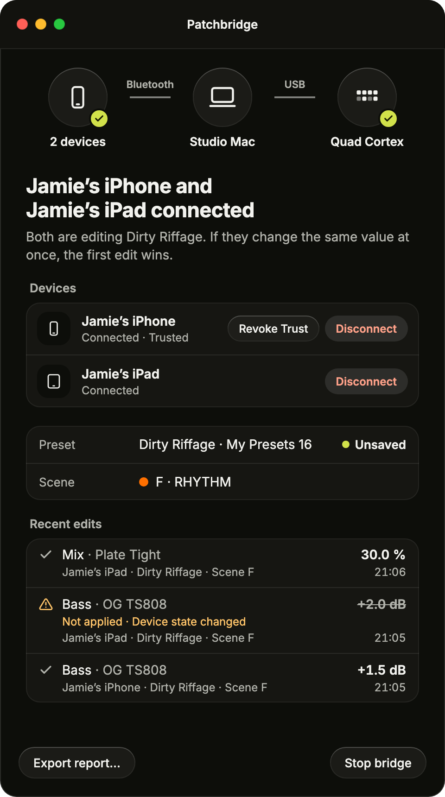</a><br><sub>Two devices connected</sub></td></tr>
</table>

### Running in the menu bar

Closing the window leaves Patchbridge running in the menu bar, so the iPhone keeps editing; quitting or stopping the bridge releases its QC session. The menu bar icon changes shape for each state. The popover handles approval and problems without reopening the window. Planned notifications open the current approval request or report a lost QC; an old notification must never approve a new connection.

<table>
<tr><td align="center" valign="top"><a href="html/mac/m-closing.html"></a><br><sub>Closing the window</sub></td><td colspan="2" align="center" valign="top"><a href="html/mac/mb-icons.html"></a><br><sub>Menu bar icon states</sub></td><td align="center" valign="top"><a href="html/mac/mb-notify-request.html"></a><br><sub>Notification · approval</sub></td></tr>
<tr><td align="center" valign="top"><a href="html/mac/mb-notify-lost.html"></a><br><sub>Notification · QC lost</sub></td></tr>
</table>

<table>
<tr><td align="center" valign="top"><a href="html/mac/mb-ready.html"></a><br><sub>Menu bar · ready</sub></td><td align="center" valign="top"><a href="html/mac/mb-connected.html"></a><br><sub>Menu bar · connected</sub></td><td align="center" valign="top"><a href="html/mac/mb-request.html"></a><br><sub>Menu bar · approve</sub></td><td align="center" valign="top"><a href="html/mac/mb-lost.html"></a><br><sub>Menu bar · QC lost</sub></td><td align="center" valign="top"><a href="html/mac/mb-stopped.html"></a><br><sub>Menu bar · bridge stopped</sub></td></tr>
</table>

### Settings and Daylight

<table>
<tr><td align="center" valign="top"><a href="html/mac/m-settings.html"></a><br><sub>Settings</sub></td><td align="center" valign="top"><a href="html/mac/d-ready.html"></a><br><sub>Daylight · ready</sub></td><td align="center" valign="top"><a href="html/mac/d-request.html"></a><br><sub>Daylight · approve</sub></td><td align="center" valign="top"><a href="html/mac/d-connected.html"></a><br><sub>Daylight · connected</sub></td></tr>
<tr><td align="center" valign="top"><a href="html/mac/d-mb-connected.html"></a><br><sub>Daylight · menu bar</sub></td><td align="center" valign="top"><a href="html/mac/d-mb-request.html"></a><br><sub>Daylight · menu bar approve</sub></td></tr>
</table>

## Live Activity

An optional Live Activity shows the session on the Lock Screen and in the Dynamic Island. Each state has at most one button: **Disconnect** while connected, **Reconnect** after an unexpected drop, **Open Patchbridge** when the Mac needs to approve the iPhone. The rail under the title uses the Mac window's line language: solid is connected, dashed chartreuse is reconnecting, dashed amber is lost, dotted is off.

- **Show connection status** (Connection settings) turns the activity on. It starts when a session starts and ends after an intentional Disconnect, showing a final "Disconnected" state that tells you about unsaved edits before it's dismissed.
- **Alert if the connection drops** lights the screen for drops you didn't start. With the activity off it sends a regular notification instead.
- The activity doesn't keep Bluetooth alive; background connection support does that.

**Trust makes Reconnect one tap.** Today approval belongs to one connection. The Mac's approve card adds **Trust this iPhone** (on by default). While trusted, Reconnect skips the code, even after Patchbridge quits and reopens. **Revoke Trust** in the Mac's menu bar ends it; the next Reconnect then shows **Approval needed**.

### Lock Screen

<table>
<tr><td align="center" valign="top"><a href="html/live/ls-connected.html">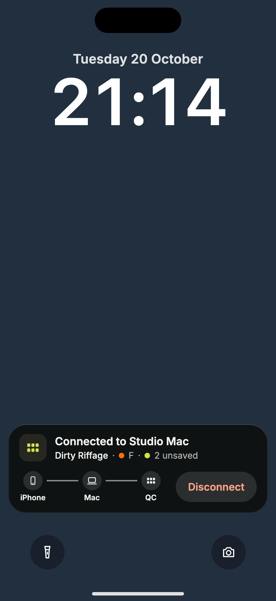</a><br><sub>Connected</sub></td><td align="center" valign="top"><a href="html/live/ls-lost.html">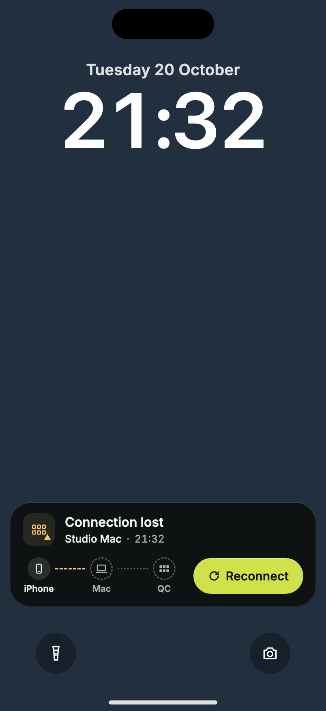</a><br><sub>Connection lost</sub></td><td align="center" valign="top"><a href="html/live/ls-reconnecting.html">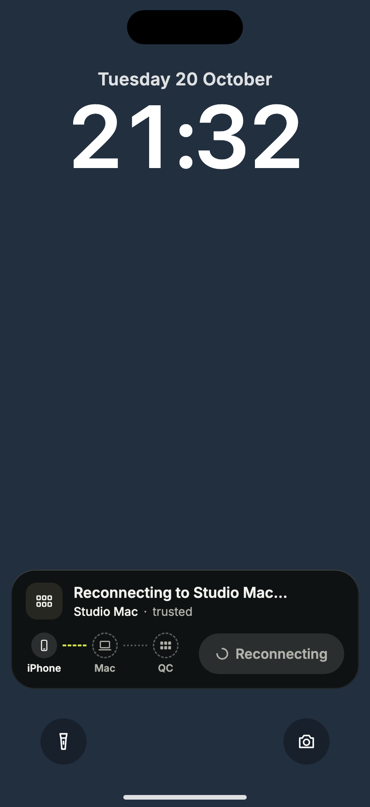</a><br><sub>Reconnecting (trusted)</sub></td><td align="center" valign="top"><a href="html/live/ls-approval.html">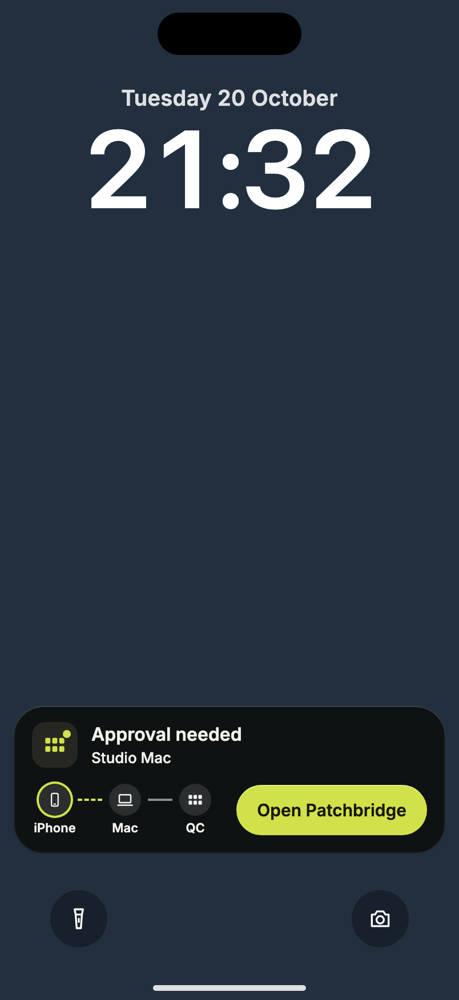</a><br><sub>Approval needed</sub></td></tr>
<tr><td align="center" valign="top"><a href="html/live/ls-ended.html">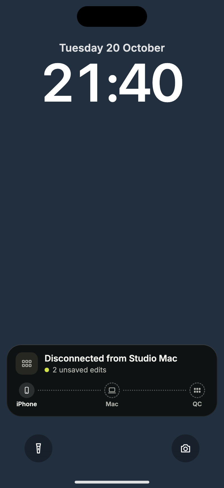</a><br><sub>Ended after Disconnect</sub></td><td align="center" valign="top"><a href="html/live/ls-alert.html">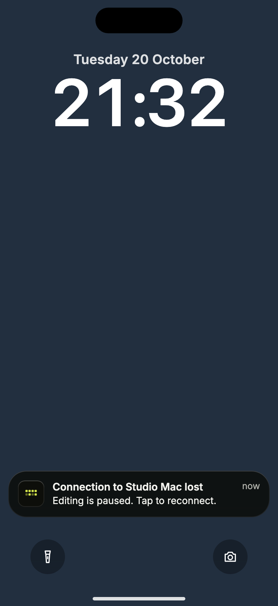</a><br><sub>Alert only · activity off</sub></td><td align="center" valign="top"><a href="html/live/ls-daylight.html">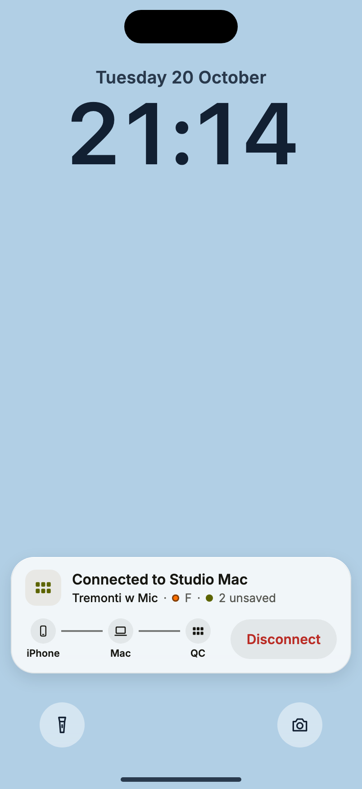</a><br><sub>Daylight · connected</sub></td></tr>
</table>

### Dynamic Island

The island is always black, so it always uses Stage colors.

<table>
<tr><td align="center" valign="top"><a href="html/live/di-compact.html">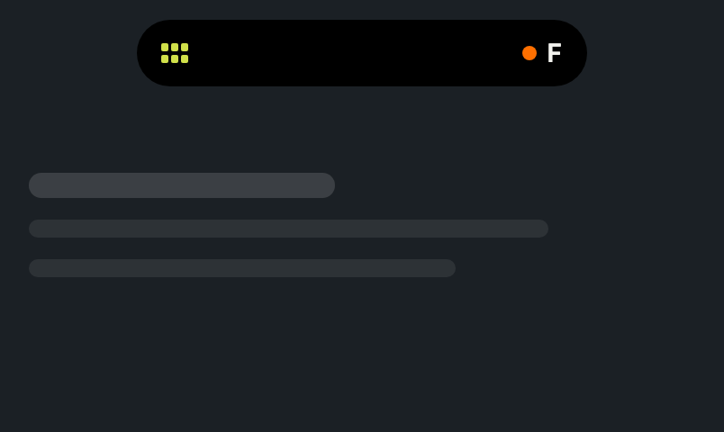</a><br><sub>Compact</sub></td><td align="center" valign="top"><a href="html/live/di-compact-lost.html">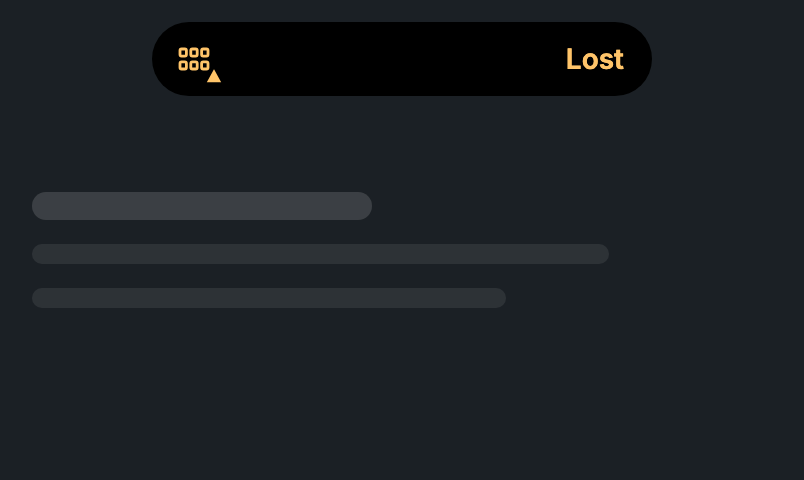</a><br><sub>Compact · lost</sub></td><td align="center" valign="top"><a href="html/live/di-compact-approval.html">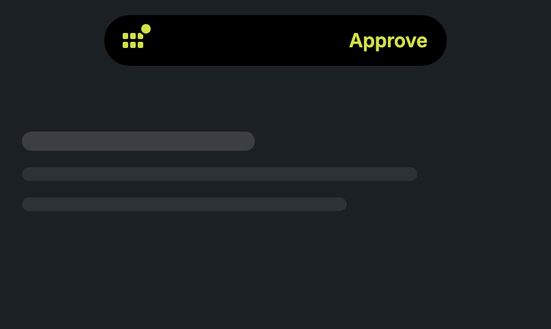</a><br><sub>Compact · approval</sub></td></tr>
<tr><td align="center" valign="top"><a href="html/live/di-minimal.html">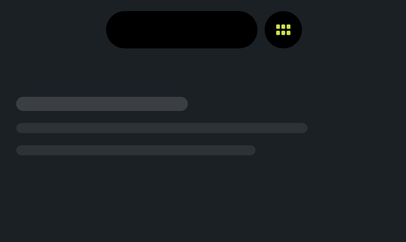</a><br><sub>Minimal</sub></td><td align="center" valign="top"><a href="html/live/di-expanded.html">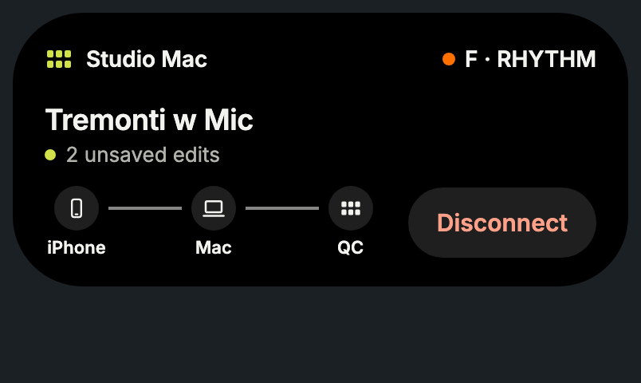</a><br><sub>Expanded</sub></td><td align="center" valign="top"><a href="html/live/di-expanded-lost.html">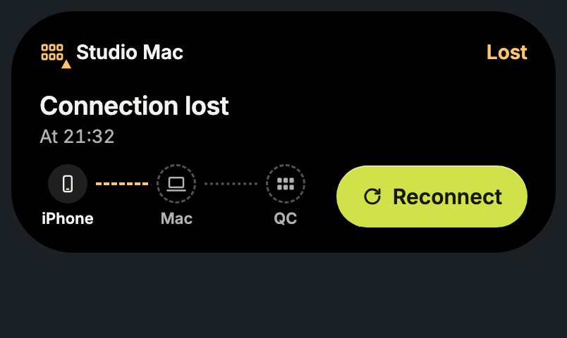</a><br><sub>Expanded · lost</sub></td></tr>
<tr><td align="center" valign="top"><a href="html/live/di-expanded-approval.html"></a><br><sub>Expanded · approval</sub></td></tr>
</table>

### The setting, and trust on the Mac

<table>
<tr><td align="center" valign="top"><a href="html/live/st-connection.html"></a><br><sub>iPhone · Connection settings</sub></td><td align="center" valign="top"><a href="html/live/mac-approve-trust.html"></a><br><sub>Mac · approve and trust</sub></td><td align="center" valign="top"><a href="html/live/mac-trusted.html"></a><br><sub>Mac · trusted, connected</sub></td><td align="center" valign="top"><a href="html/live/mac-trusted-away.html"></a><br><sub>Mac · trusted, not connected</sub></td></tr>
</table>

## Tuner

The live tuner, as built. On iPhone a slim line under the status bar carries the note, bar and cents; its light rises into the status bar and the ring around the Dynamic Island lights in tune. It stays on every screen until Live tuner is turned off in the full tuner, which also holds Mute output. The canvas's Tuner page also keeps the placements that weren't chosen (a top strip, a header takeover, a floating pill, an always-on iPad element and a Duo band); they aren't rendered here.

<table>
<tr><td align="center" valign="top"><a href="html/tuner/tn-island.html"></a><br><sub>Tuner line · sharp, light rising into the status bar</sub></td><td align="center" valign="top"><a href="html/tuner/tn-island-tuned.html"></a><br><sub>Tuner line · in tune, island ring lit</sub></td><td align="center" valign="top"><a href="html/tuner/tn-island-quiet.html"></a><br><sub>Tuner line · no signal</sub></td><td align="center" valign="top"><a href="html/tuner/tn-island-editor.html"></a><br><sub>Tuner line · stays on in the block editor</sub></td></tr>
<tr><td align="center" valign="top"><a href="html/tuner/tn-sheet.html"></a><br><sub>Full tuner · muted</sub></td><td align="center" valign="top"><a href="html/tuner/tn-sheet-quiet.html"></a><br><sub>Full tuner · no signal, live on</sub></td></tr>
</table>

On iPad the full tuner is a popover from the tuner button; the live tuner is a band in the top bar's free space, and its own full-width row in portrait.

<table>
<tr><td align="center" valign="top"><a href="html/tuner/tn-popover.html"></a><br><sub>Popover from the tuner button</sub></td><td align="center" valign="top"><a href="html/tuner/tn-band.html"></a><br><sub>Live tuner as a top-bar band</sub></td></tr>
<tr><td align="center" valign="top"><a href="html/tuner/tn-band-portrait.html"></a><br><sub>Live tuner band, portrait</sub></td></tr>
</table>

On the iPhone Duo's inner screen the full tuner is a popover too, and the live tuner is the crease: its bar runs along the fold and its light spills into both halves, widening as the string comes into tune. The fold gets the same extra room flat and half-folded, so folding still moves nothing.

<table>
<tr><td align="center" valign="top"><a href="html/tuner/duo-tn-popover.html"></a><br><sub>Popover from the tuner button</sub></td><td align="center" valign="top"><a href="html/tuner/duo-tn-crease-far.html"></a><br><sub>Crease · 14¢ flat, light follows the marker</sub></td><td align="center" valign="top"><a href="html/tuner/duo-tn-crease-close.html"></a><br><sub>Crease · 6¢ sharp, light widening</sub></td></tr>
<tr><td align="center" valign="top"><a href="html/tuner/duo-tn-crease-tuned.html"></a><br><sub>Crease · in tune, light across the fold</sub></td><td align="center" valign="top"><a href="html/tuner/duo-tn-crease-half.html"></a><br><sub>Crease · half-folded, nothing moves</sub></td></tr>
</table>

## Engineering dependencies

These designs assume changes that aren't built yet:

- **Scene data:** `PresetSnapshot` and `tools/export_editor_fixture.py` need `scene_labels` and `scene_colors` from the QC.
- **Approval code:** both clients now derive a short display code from the full connection UUID. Authorization continues to use the full token.
- **Fine steps:** the 0.05 hold-and-slide gesture should send only the final value on release.
- **Scene switching:** built offline. The USB adapter's `select_scene` reports applied, refused before the write ("Not applied", including `device_busy`) or unknown (`not_confirmed`); scene changes made on the QC arrive through polling. Readback is authoritative for `dirty`; that the QC leaves it unchanged is still to be checked on hardware.
- **Capabilities:** scene switching, bypass writes, Save As and preset switching stay hidden until the bridge advertises them.
- **Mac app distribution:** Get Patchbridge for Mac assumes a Mac App Store link. A direct download changes only the link and the App Store wording. The short typeable address is a placeholder.
- **Menu bar mode:** the offline shell now keeps running when its window closes, with a menu bar popover and a keep-running setting. Dock visibility and opt-in launch-at-login now use native macOS services. Stop and Quit both end the session.
- **Bridge state for the Mac UI:** the window and popover need the current preset, scene and unsaved flag from the coordinator.
- **Cortex Control and firmware checks:** the bridge needs to detect an unavailable USB connection, and to refuse writes on untested CorOS versions.
- **Notifications:** approval requests and a lost QC are posted as macOS notifications, which needs notification permission.
- **Fold posture:** the Duo layouts switch on hinge posture (flat, half-folded, closed). The half-folded layout needs the app to know that the device is half open, not just its size class. Without that signal, it falls back to the unfolded layout; the app implements the half-folded view and keeps it behind that signal (Debug builds can force it with `--half-folded`). The hinge position (across the inner screen's long side) is inferred from the screen sizes and should be checked against the hardware.

## Mac implementation contract (2026-10-20)

The current Mac package starts stopped and offers live USB/Bluetooth and a visibly labelled
simulation mode. It uses the shared Patch Cable icon and implements the window,
approval code, snapshot facts, menu bar, appearance, close-window preference, Dock
visibility, optional notifications, login registration and bounded recent-edit history.
Notifications and login launch default off; Dock visibility defaults on. The login
control reports actual OS status, including unavailable for this local ad-hoc build. Use actual bundle version information, never the sample build number.

Device labels are display data, not identity proof. Advertise the Mac’s actual computer
name; exchange it in hello. The phone sends an optional app display name and falls back
to “iPhone”; a Mac name falls back to “Mac”. Do not assume access to an iPhone’s personal
system name. Names are bounded and stripped of control/direction override characters.

The opt-in bridge recovery path preserves approval only while the same phone transport
and helper remain alive. Retry device connection with 1–8 second backoff, load a new
snapshot and capabilities before edits resume, and never replay edits or saves. A helper
crash or phone disconnect invalidates approval. Physical USB removal remains unverified.

“Not applied” requires an explicit pre-write rejection; a failed readback or timeout is
“Outcome unknown”. Keep that distinction after recovery; a successful connection is not
proof of the interrupted write outcome. Show scene names/colors only when supplied by
the device; otherwise use the scene letter. Preset, firmware and dirty state are live
facts only after a confirmed read; retained facts during recovery are labelled last known.

Missing boards: Bluetooth denied/restricted, startup/loading, withdrawn approval, second
phone, intentionally stopped, read-only, empty activity, and uncertain save. Reuse the
existing status layout with a single recovery action and amber text plus an icon for
attention; no fabricated data. Use the native notification layout and open the live
request to compare codes. Settings use native controls; unavailable features are omitted.
